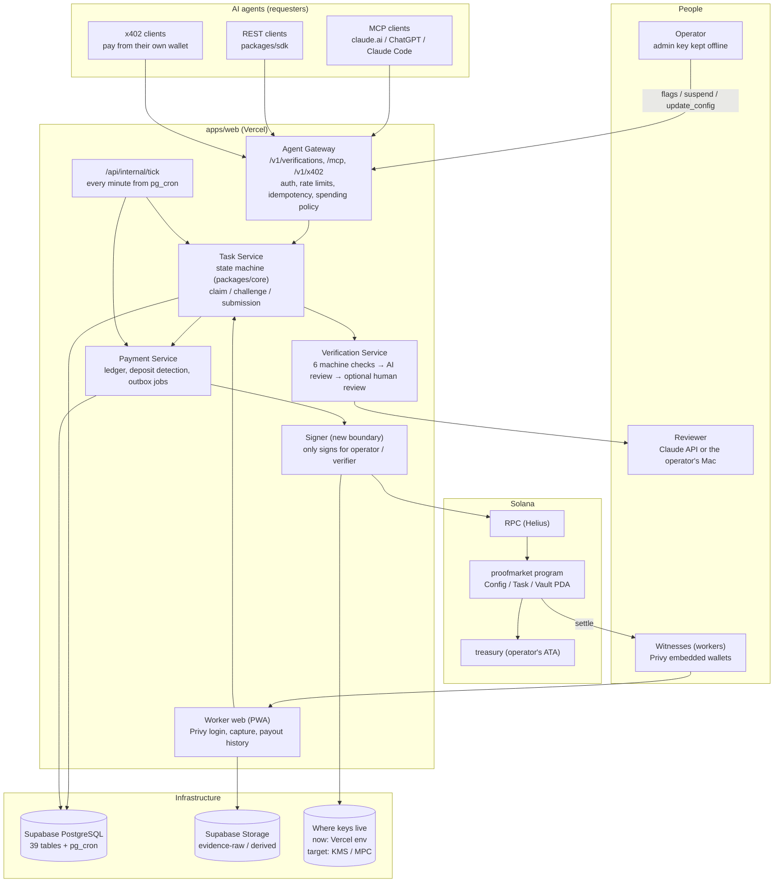

# 03. Target architecture: keep the single app, harden three boundaries

Written: 2026-10-14

## 1. Purpose

Step 3 of the brief. We lay the structure the brief gives (AI Agents → Agent API → Task Management → Database / Verification / Payment → Solana → Workers) over ProofMarket's implementation and decide what changes and what stays. Details of each component are left to chapters 04-09; this chapter covers only how they relate.

## 2. Current state

As chapter 01 shows, every component in the brief is implemented inside one Next.js app, `apps/web`, and `packages/*`. The mapping from logical components to code is as in the table in the existing spec 02 §2: the Agent Gateway is `app/v1/verifications/**` and `lib/auth/requester.ts`; the Task Service is `packages/core/src/task/**` and `lib/services/task-service.ts`; the Verification Engine is `packages/core/src/verification/**` and `lib/services/verification-service.ts`; the Settlement Adapter is `packages/solana/src/**`; the program is `programs/proofmarket/**`.

## 3. Requirements

Cover the design targets in sections 4.1-4.5 of the brief (Agent API, Task Management, USDC Escrow, Verification Service, Worker Interface), stay compatible with the existing API, and avoid a full rewrite. Of the security requirements in section 8, three are guaranteed by structure: "agents cannot spend without limit", "secret keys are not left unprotected on the server" and "there is a kill switch".

## 4. Proposed design

### 4.1 Diagram

### 4.2 What stays

The single Next.js app, Supabase, the Anchor escrow, Privy, the outbox and tick, and the three-key split all stay. They work, and the brief asks us to "avoid unnecessary full rewrites". The API routes (`/v1/verifications`, `/mcp`, `/v1/x402/verifications`) and response shapes stay too.

### 4.3 What changes (three boundaries)

**Boundary 1: a spending policy in the Agent Gateway.** Today the balance is the only brake, and the credential limits are merely stored. The create path in the gateway (`createVerification`) checks the per-request limit and the daily total and refuses with `SPEND_LIMIT_EXCEEDED` when exceeded. MCP also gains a "quote" tool, so a client can choose a two-step flow that returns the cost first and then confirms (chapters 04, 06, 08).

**Boundary 2: a Signer between the Payment Service and the keys.** `packages/solana` stops holding a `Keypair` directly and gets an interface that only takes transaction bytes and returns a signature. The first implementation uses the same env-var keys as today, so behaviour does not change. Next, KMS or MPC backends from `@solana/keychain` can be plugged in to take the mainnet operator key off the server (chapters 05, 08).

**Boundary 3: in the Verification Service, a switch by amount for "a person checks before an irreversible payment".** Today `external_review_enabled` either holds every submission or none. Require human review only for requests whose bounty exceeds a threshold, and pay on AI judgement below it. The threshold is an env var defaulting to "never hold" (today's behaviour) (chapter 07). **The owner withdrew this boundary on 2026-10-16: how much to check before paying is the requester's decision (07 §4.2).**

### 4.4 Mapping to the brief's lifecycle

The brief gives eight stages: Draft → Pending Funding → Open → Accepted → Submitted → Under Review → Approved → Paid. They map to ProofMarket's states as follows; no new states are added.

| Brief | ProofMarket | Note |
|---|---|---|
| Draft | (none) | A request becomes CREATED once the create API's checks pass. x402's "preview" (try the create and roll it back before answering 402) plays the role of a draft |
| Pending Funding | CREATED | Waiting for the FUND_TASK job |
| Open | FUNDED → OPEN | |
| Accepted | CLAIMED | There can be several witnesses, so acceptance is held on the claim |
| Submitted | SUBMITTED | |
| Under Review | VERIFYING (within one transaction), or a submission in `CHECKING` (waiting for human review) | |
| Approved | VERIFIED | Consensus reached; settlement is PENDING |
| Paid | SETTLED | settle is finalized |
| Cancelled / Expired / Rejected / Refunded | CANCELLED / EXPIRED / REJECTED / REFUNDED | As today |
| Disputed | (not a state) | A dispute creates a recheck request; GET on the original shows `recheck` |

## 5. Rationale

All three boundaries fit inside existing modules, so no new service or deployment target is added. The Signer is separated so the place keys live can change without touching settlement code, using the nextjs-keychain pattern of "several backends behind one interface". The spending policy goes in the gateway because REST, MCP and x402 all go through the same `createVerification`: written once, it covers all three.

## 6. Alternatives

- Splitting settlement into a separate service (e.g. Rust axum). templates has an axum sample, but it would mean two deployment targets and break the transaction boundary with the outbox. Throughput is addressed first by the parallelism in PR #40
- A separate verification service. AI review is one Claude API call; splitting it gains nothing
- Moving tick to Supabase Edge Functions. Recorded only as an escape hatch if Vercel's 300-second function limit becomes a problem

## 7. Security considerations

The three structural guarantees match the boundaries in 4.3: unlimited spending is held back by boundary 1, key exposure by boundary 2, and irreversible AI judgements by boundary 3. The existing `platform_flags` (`tasks_create_enabled`, `claims_enabled`, `settlement_enabled`, `public_evidence_enabled`, `external_review_enabled`) and the program's `paused` are enough for kill switches, but there is no flag to stop the x402 window on its own. Add `x402_enabled` (chapter 08).

## 8. Implementation issues

The Signer boundary changes the arguments of `createAnchorAdapter` (`operatorSecretKey: Uint8Array`), so calls in `apps/web/lib/context.ts` and `scripts/*.ts` change together. For compatibility, keep the old API that takes a `Uint8Array` as a thin wrapper (chapter 10).

## 9. Test strategy

All three changes fit existing test layers. Spending policy: add negative tests for exceeding limits to `apps/web/test/requester-api.test.ts`. Signer: pin with the fake RPC in `packages/solana/test/send.test.ts` that the bytes do not change across signing. Review threshold: add two cases to `apps/web/test/external-review.test.ts`, below the threshold not held and above it held.

## 10. Open questions

- The backend for boundary 2 (as in 02 §10)
- The default threshold for boundary 3: in USDC, or per currency (more currencies arrive with the multi-token PR #41)
- Whether to add a "draft API" to REST equivalent to the brief's Draft. x402's preview seems enough, so not for now (proposal)
