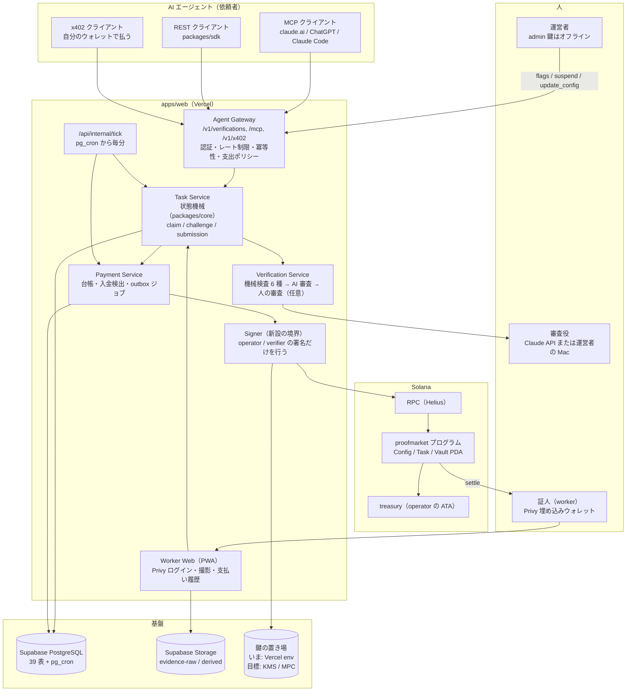

# 03. 目標アーキテクチャ: 単一アプリの構成は保ち、境界を 3 箇所で固める

作成: 2026-10-14

## 1. 目的

指示書の第 3 段階に当たる。指示書が示した構成（AI Agents → Agent API → Task Management → Database / Verification / Payment → Solana → Workers）を ProofMarket の実装に重ね、変える点と変えない点を決める。各コンポーネントの詳細は 04〜09 章に委ね、この章は全体の関係だけを扱う。

## 2. 現状

01 章のとおり、指示書の構成要素はすべて `apps/web` の 1 つの Next.js アプリと `packages/*` の中に実装されている。論理コンポーネントと実装の対応は既存仕様 02 §2 の表のままで、Agent Gateway が `app/v1/verifications/**` と `lib/auth/requester.ts`、Task Service が `packages/core/src/task/**` と `lib/services/task-service.ts`、Verification Engine が `packages/core/src/verification/**` と `lib/services/verification-service.ts`、Settlement Adapter が `packages/solana/src/**`、Program が `programs/proofmarket/**` である。

## 3. 要件

指示書の 4.1〜4.5 の設計対象（Agent API、Task Management、USDC Escrow、Verification Service、Worker Interface）を満たし、既存の API と互換を保ち、全面的な書き換えをしない。さらに第 8 節のセキュリティ要件のうち、「エージェントが無制限に資金を使えない」「秘密鍵をサーバーに無防備に置かない」「緊急停止がある」の 3 つを構成として保証する。

## 4. 提案する設計

### 4.1 構成図

### 4.2 変えない点

単一の Next.js アプリ、Supabase、Anchor のエスクロー、Privy、outbox と tick、3 本の鍵の役割分担は変えない。これらは動いており、指示書も「必要のない全面的な書き換えは行わない」と求めている。API の経路（`/v1/verifications`、`/mcp`、`/v1/x402/verifications`）と応答の形も変えない。

### 4.3 変える点（3 つの境界）

**境界 1: Agent Gateway に支出ポリシーを置く。** いまは残高だけが歯止めで、credential の上限は保存されるだけである。Gateway の作成処理（`createVerification`）で 1 件の上限と 1 日の累計を検査し、超えたら `SPEND_LIMIT_EXCEEDED` で断る。あわせて MCP に「見積もり」の道具を足し、費用を先に返してから確定させる 2 段階を選べるようにする（04 章、06 章、08 章）。

**境界 2: Payment Service と鍵の間に Signer を置く。** `packages/solana` が `Keypair` を直接持つ作りをやめ、「取引のバイト列を受けて署名を返す」だけのインターフェースにする。最初の実装は今と同じ環境変数の鍵で、動作は変わらない。次に `@solana/keychain` の KMS や MPC のバックエンドを差し込めるようにし、メインネットの operator 鍵をサーバーから出す（05 章、08 章）。

**境界 3: Verification Service に「不可逆な支払いの前の人の確認」を額で切り替える仕組みを置く。** いまは `external_review_enabled` が全提出を止めるか止めないかの二択である。報酬が閾値を超える依頼だけ人の審査を必須にし、それ以下は AI の判定で払う。閾値は環境変数で、既定は「止めない」（いまと同じ）にする（07 章）。

### 4.4 指示書のライフサイクルとの対応

指示書は Draft → Pending Funding → Open → Accepted → Submitted → Under Review → Approved → Paid の 8 段階を示す。ProofMarket の状態との対応は次のとおりで、新しい状態は足さない。

| 指示書 | ProofMarket | 備考 |
|---|---|---|
| Draft | （無い） | 作成 API が検査を通した時点で CREATED になる。下書きは x402 の「下見」（402 を返す前に作成を試して取り消す）が担う |
| Pending Funding | CREATED | FUND_TASK ジョブが待ち |
| Open | FUNDED → OPEN | |
| Accepted | CLAIMED | 複数の証人がいるので、引き受けはクレーム側の状態で持つ |
| Submitted | SUBMITTED | |
| Under Review | VERIFYING（同一トランザクション内）、または `CHECKING` の提出（人の審査待ち） | |
| Approved | VERIFIED | 合意に達した。settlement は PENDING |
| Paid | SETTLED | settle が finalized |
| Cancelled / Expired / Rejected / Refunded | CANCELLED / EXPIRED / REJECTED / REFUNDED | 既存どおり |
| Disputed | （状態ではない） | 異議は再確認の依頼を作る。元の依頼の GET に `recheck` が付く |

## 5. 技術選定の理由

3 つの境界はいずれも既存のモジュールの内側に置けるので、新しいサービスやデプロイ先を増やさない。Signer を独立させる理由は、鍵の置き場を変えるときに決済のコードを触らずに済ませるためで、nextjs-keychain が示す「1 つのインターフェースの裏にバックエンドを並べる」型をそのまま使う。支出ポリシーを Gateway に置くのは、REST・MCP・x402 の 3 経路がすべて同じ `createVerification` を通るからで、1 箇所に書けば 3 経路に効く。

## 6. 代替案

- 決済を別サービス（Rust の axum など）に切り出す案。templates にも axum の見本があるが、デプロイ先が 2 つになり、outbox とのトランザクション境界が切れる。処理量の問題は PR #40 の並列化で先に試す
- 検証を別サービスにする案。AI 審査は Claude の API 呼び出し 1 回なので、分ける利点がない
- Supabase Edge Functions に tick を移す案。Vercel の関数の 300 秒上限が問題になったときの逃げ道として記録するにとどめる

## 7. セキュリティ上の考慮事項

構成として守る 3 点は 4.3 の境界に対応する。無制限の支出は境界 1、鍵の露出は境界 2、不可逆な AI 判定は境界 3 で抑える。緊急停止は既存の `platform_flags`（`tasks_create_enabled`、`claims_enabled`、`settlement_enabled`、`public_evidence_enabled`、`external_review_enabled`）とプログラムの `paused` で足りているが、x402 の窓口を単独で止める旗が無い。`x402_enabled` を足す（08 章）。

## 8. 実装上の課題

Signer の境界は `createAnchorAdapter` の引数（`operatorSecretKey: Uint8Array`）を変えるので、`apps/web/lib/context.ts` と `scripts/*.ts` の呼び出しが一斉に変わる。互換のため、`Uint8Array` を受け取る旧 API は薄い包みとして残す（10 章）。

## 9. テスト方針

構成の変更は 3 箇所とも既存のテスト層で受けられる。支出ポリシーは `apps/web/test/requester-api.test.ts` に上限超過の否定テストを足す。Signer は `packages/solana/test/send.test.ts` の偽 RPC で、署名前後のバイト列が変わらないことを固定する。審査の閾値は `apps/web/test/external-review.test.ts` に、閾値未満は止まらず閾値以上は止まる 2 件を足す。

## 10. 未決定事項

- 境界 2 のバックエンド（02 §10 と同じ）
- 境界 3 の閾値の既定値。USDC 建てで決めるか、通貨ごとに決めるか（多通貨の PR #41 が入ると通貨が増える）
- 指示書の Draft に相当する「下書き API」を REST にも足すか。x402 の下見で足りているとみて、いまは足さない（提案）
