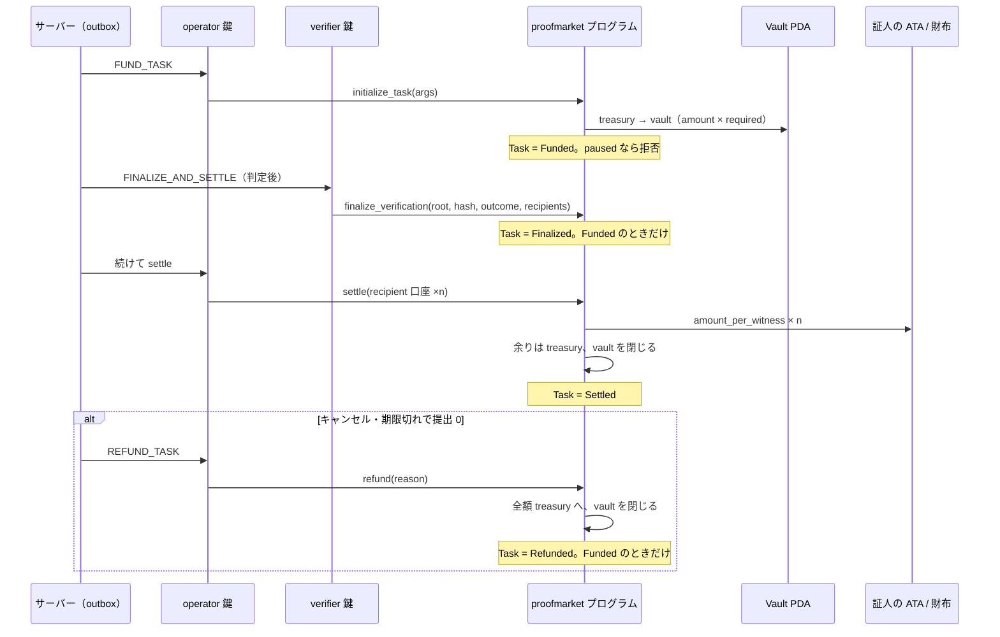

# 05. エスクロー設計: プログラムは十分に固い。弱いのは鍵の置き場

作成: 2026-10-14 ／ 正本は `specs/proofmarket/implementation/ja/06-solana-program-design.md`、点検記録は `docs/security/program-review-2026-10-13.md`

## 1. 目的

指示書 4.3 の 8 項目（預け入れ、預入の確認、ロック、承認後の解放、キャンセル時の返金、紛争時の保全、二重支払い防止、取引履歴）を既存のプログラムに照らし、足りないものを設計する。あわせて「秘密鍵をサーバー上に無防備に保存しない」を満たす署名の境界を決める。

## 2. 現状

Anchor 1.2 のプログラム v1.2 が Devnet（`A9frCat4fv1rKRKF4sAg6WT8LaUwm4CvJ1JZb81kgC2s`）で動いている。口座は 4 種で、`Config`（seeds `["config"]`。admin、operator、verifier、bounty_mint、treasury、max_witnesses、paused）、`AllowedMint`（seeds `["mint", mint]`。USDC 以外に預かれる mint）、`Task`（seeds `["task", task_id_hash]`。公開の領収書として永久に残る）、`Vault`（seeds `["vault", task]`。トークン口座、settle か refund で閉じる）である。`task_id_hash` は `SHA-256("proofmarket:task:v1:" + verification_id)` で、同じ依頼は二度資金化できない。

命令と状態の対応を下に示す。状態は `Funded → Finalized → Settled` と `Funded → Refunded` の 2 本道で、`Settled` と `Refunded` から先はない。



指示書の 8 項目との対応は次のとおり。

| 項目 | 実装 | 評価 |
|---|---|---|
| 報酬の預け入れ | `initialize_task`。treasury（operator の ATA）から vault へ | Implemented |
| 預入資金の確認 | サーバーは Task 口座を読んでから次に進む（`anchor-adapter.ts`）。公開ページはブラウザから照合（`packages/sdk/onchain`） | Implemented |
| 資金のロック | vault は PDA で、プログラム以外は動かせない | Implemented |
| 承認後の解放 | `finalize_verification` → `settle`。受取人は verifier が決め、operator が払う | Implemented |
| キャンセル時の返金 | `refund(Cancelled)`。`Funded` のときだけ | Implemented |
| 紛争時の資金保全 | 無し。異議は再確認の依頼を新しく作る（01 §4.12）ので、元の資金は止めない | Missing（設計どおり） |
| 二重支払い防止 | 状態検査、`settle` と `refund` の排他、`payment_records` の `settle_xor_refund` 索引、outbox の `dedupe_key` | Implemented |
| 取引履歴 | `payment_records`（署名の配列、確認時刻）、イベント 4 種（`TaskInitialized`、`VerificationFinalized`、`TaskSettled`、`TaskRefunded`） | Implemented |

鍵は 3 本に分かれ、admin はサーバーに置かず、operator と verifier は Vercel の環境変数に base58 で置く。`initialize_config` は operator ≠ verifier を要求するので、1 本が漏れただけでは自分を受取人にして払えない。LiteSVM のテストは 23 本で、v1.3（PR #42、Token-2022 対応）で 29 本になる。

## 3. 要件

- 命令と口座の設計は変えない（v1.3 の差分は審査中の PR #42 に委ねる）
- operator と verifier の署名を、鍵の置き場から切り離せる境界を設ける
- プログラムの更新権限を、配置した鍵から別の鍵へ移す手順を決める
- treasury に置く額の上限と、超えた分を admin へ移す手順を決める

## 4. 提案する設計

### 4.1 Signer の境界

`packages/solana` に次のインターフェースを置く。

```ts
export interface Signer {
  readonly publicKey: PublicKey;
  /** 署名すべきメッセージのバイト列を受け、64 バイトの署名を返す。本文は変えない */
  sign(message: Uint8Array): Promise<Uint8Array>;
}
```

`createAnchorAdapter` は `operatorSecretKey: Uint8Array` の代わりに `operator: Signer` と `verifier: Signer` を受ける。最初の実装 `keypairSigner(secret)` は今と同じ `Keypair` を包むだけで、動作は変わらない。`send.ts` は `VersionedTransaction.message.serialize()` を `sign()` に渡し、返った署名を `addSignature` で付ける。Anchor の `Program` は `AnchorProvider` にウォレットを要求するが、ProofMarket はすでに自前の最小ウォレット（`keypairWallet`）を渡しているので、そこを `Signer` 経由にする。

2 つ目の実装 `keychainSigner(backend)` は `@solana/keychain` の `SolanaSigner` を包む。keychain は `@solana/kit` の型で取引を受けるので、web3.js v1 の `VersionedTransaction` を `getTransactionDecoder` で kit の形に変換して `signTransactions` を呼び、署名だけを取り出す。bytes が同じなら署名は同じなので、橋は 30 行程度で済む（推測。実装時に `send.test.ts` で固定する）。バックエンドは環境変数（`SIGNER_BACKEND=memory|aws-kms|gcp-kms|privy|turnkey`）で選び、`OPERATOR_SECRET_KEY` は `memory` のときだけ読む。

### 4.2 更新権限とマルチシグ

プログラムの upgrade authority は、メインネットに配置した直後に `solana program set-upgrade-authority` で admin 鍵（ハードウェア財布）へ移す。Squads のマルチシグ（2-of-3）が望ましいが、運営者が 1 人のあいだは閾値を 1 にしたマルチシグに意味がないので、ハードウェア財布 1 本から始め、共同運営者ができた時点でマルチシグに移す。`Config.admin` も同じ鍵にする。手順は 12 §10 に追記する。

### 4.3 treasury の上限

15 §4.2 の「1 日の支払い見込みの 2 倍」を数字にする。開始時の見込みは 1 日 50 USDC 以下（推測。本番の実数は未読）なので、上限を 200 USDC と 2 SOL（手数料と rent 用）に置き、tick が毎分の残高検査（08 §5 の既存の警告）で上限の 1.5 倍を超えたら警告する。移し替えは自動化せず、運営者が admin の財布へ送る。自動化すると operator 鍵が admin への送金もできることになり、漏えい時に被害が広がる。

### 4.4 紛争時の保全について

指示書は紛争時の資金保全を求めるが、いまの設計では異議が元の資金を止めない。これは D-08（判定を通った提出にはすべて払う）の帰結で、証人を守るための決定である。保全を入れるなら、`finalize_verification` の後に「異議期間」を置いて `settle` を遅らせる形になるが、証人への支払いが遅れ、プログラムに時間の制限を入れることになる（D-11 と衝突する）。足さない。代わりに、楽観的な確認（13 §3）が異議期間つきの道として既にあり、依頼者はそれを選べる。

## 5. 技術選定の理由

Signer を `sign(bytes)` の 1 メソッドにしたのは、KMS も MPC もハードウェア財布も最終的にこの形に落ちるからで、nextjs-keychain が 13 のバックエンドを 1 つの型で扱えているのも同じ理由による。Anchor の `Program` をそのまま使い続けるのは、命令の組み立てと口座の検証を IDL に任せられるからで、ここを手書きに戻す利点はない。

## 6. 代替案

- operator 鍵を Privy のサーバーウォレットに置く案。Privy はすでに worker 側で契約しているので、追加の契約が要らない。keychain に `privy` バックエンドがあるので 4.1 の枠で試せる
- 署名サーバーを別に立てる案（nextjs-keychain の形）。Vercel の関数から別サーバーへの往復が増え、署名 1 回に数百 ms が足される。決済ジョブの処理量（16 §7）に響くので、まずは同じプロセスで KMS を呼ぶ
- プログラムに依頼者ごとの支出上限を持たせる案。04 章で退けた

## 7. セキュリティ上の考慮事項

点検記録が挙げた注意点のうち、設計で答えるのは 1（operator は `Funded` の task をいつでも返金できる）と 5（更新権限）である。1 は Signer を KMS に移しても消えない。KMS は署名を速く出すだけで、何に署名するかは判断しない。operator 鍵の濫用に対する歯止めは、サーバー側の検査（向かっている証人がいれば取り消さない）と treasury の上限であり、4.3 の上限がその被害の天井になる。

`settle` の受取人は verifier が記録し、operator はそれを変えられない。verifier 鍵も Signer の裏に置くので、KMS に移すときは 2 本とも移す。1 本だけ移しても、もう 1 本が環境変数にある限り「サーバーの鍵 2 本が漏れる」事故の確率は下がらない。

## 8. 実装上の課題

- `scripts/devnet-setup.ts` と `mainnet-setup.ts` は `Keypair` を直接使う。Signer に揃えるか、スクリプトは手元で動くので `memory` のままにするかを決める（後者を提案。配置の作業は手元で admin が行う）
- KMS の呼び出しには Vercel の関数からの到達性と IAM の設定が要る。手元の localnet テストでは `memory` を使う
- `send.ts` の再送（2 秒ごと）は署名済みの同じバイト列を送り直すので、再送のたびに KMS を呼ぶことはない

## 9. テスト方針

`packages/solana/test/send.test.ts` に、`keypairSigner` と「署名を記録する偽の Signer」で同じ取引を署名し、署名と本文が一致することを固定するテストを足す。localnet（`PM_LOCALNET=1`）では `memory` で全命令を往復させる（既存の 7 件）。KMS のバックエンドは、契約後に Devnet で `devnet-setup` 相当の往復を 1 回流して確かめる（CI には入れない。鍵が要るため）。

## 10. 未決定事項

- KMS のバックエンド（AWS、GCP、Privy、Turnkey）と費用
- treasury の上限の値（4.3 の 200 USDC と 2 SOL は仮）
- 第三者監査を受けるか、受けるなら v1.3 の配置前か後か
