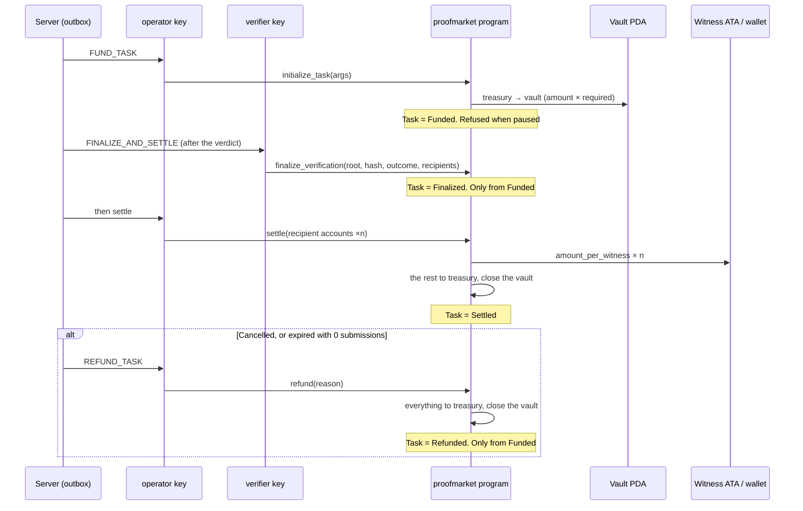

# 05. Escrow design: the program is solid; where the keys live is weak

Written: 2026-10-14 / Authoritative: `specs/proofmarket/implementation/en/06-solana-program-design.md`; review record: `docs/security/program-review-2026-10-13.md`

## 1. Purpose

Check the eight items in section 4.3 of the brief (deposit, confirming the deposit, locking, release after approval, refund on cancellation, protecting funds during a dispute, preventing double payment, transaction history) against the existing program, and design what is missing. Also decide a signing boundary that satisfies "do not store secret keys unprotected on the server".

## 2. Current state

Program v1.2 on Anchor 1.2 runs on Devnet (`A9frCat4fv1rKRKF4sAg6WT8LaUwm4CvJ1JZb81kgC2s`). There are four account types: `Config` (seeds `["config"]`; admin, operator, verifier, bounty_mint, treasury, max_witnesses, paused), `AllowedMint` (seeds `["mint", mint]`; mints other than USDC that may be escrowed), `Task` (seeds `["task", task_id_hash]`; stays forever as a public receipt) and `Vault` (seeds `["vault", task]`; a token account closed by settle or refund). `task_id_hash` is `SHA-256("proofmarket:task:v1:" + verification_id)`, so the same request cannot be funded twice.

Instructions and states below. There are two paths, `Funded → Finalized → Settled` and `Funded → Refunded`, and nothing follows `Settled` or `Refunded`.



Against the eight items:

| Item | Implementation | Rating |
|---|---|---|
| Depositing the bounty | `initialize_task`: treasury (operator's ATA) → vault | Implemented |
| Confirming the deposit | The server reads the Task account before moving on (`anchor-adapter.ts`); the public page checks it from the browser (`packages/sdk/onchain`) | Implemented |
| Locking funds | The vault is a PDA; only the program can move it | Implemented |
| Release after approval | `finalize_verification` → `settle`. The verifier decides recipients, the operator pays | Implemented |
| Refund on cancellation | `refund(Cancelled)`, only from `Funded` | Implemented |
| Protecting funds in a dispute | None. A dispute creates a new recheck request (01 §4.12), so the original funds are not held | Missing (by design) |
| Preventing double payment | State checks, `settle` and `refund` exclusive, the `settle_xor_refund` index on `payment_records`, the outbox `dedupe_key` | Implemented |
| Transaction history | `payment_records` (array of signatures, confirmation time) and four events (`TaskInitialized`, `VerificationFinalized`, `TaskSettled`, `TaskRefunded`) | Implemented |

Keys are split three ways: admin is never on the server; operator and verifier are in Vercel env vars as base58. `initialize_config` requires operator ≠ verifier, so leaking one key is not enough to pay yourself. There are 23 LiteSVM tests, 29 with v1.3 (PR #42, Token-2022 support).

## 3. Requirements

- Do not change the instruction and account design (v1.3's differences are left to PR #42 under review)
- Add a boundary that separates operator and verifier signing from where the keys are kept
- Decide how to move the program's upgrade authority from the deploying key to another key
- Decide a cap on what the treasury holds, and how to move the excess to admin

## 4. Proposed design

### 4.1 The Signer boundary

Add this interface to `packages/solana`:

```ts
export interface Signer {
  readonly publicKey: PublicKey;
  /** Takes the bytes of the message to sign and returns a 64-byte signature. Never changes the message */
  sign(message: Uint8Array): Promise<Uint8Array>;
}
```

`createAnchorAdapter` takes `operator: Signer` and `verifier: Signer` instead of `operatorSecretKey: Uint8Array`. The first implementation, `keypairSigner(secret)`, just wraps today's `Keypair`, so behaviour does not change. `send.ts` passes `VersionedTransaction.message.serialize()` to `sign()` and attaches the returned signature with `addSignature`. Anchor's `Program` wants a wallet from `AnchorProvider`, but ProofMarket already passes its own minimal wallet (`keypairWallet`), which is routed through `Signer`.

The second implementation, `keychainSigner(backend)`, wraps a `SolanaSigner` from `@solana/keychain`. keychain takes transactions in `@solana/kit` types, so convert the web3.js v1 `VersionedTransaction` with `getTransactionDecoder`, call `signTransactions`, and take only the signature. Same bytes give the same signature, so the bridge is about 30 lines (guess; to be pinned in `send.test.ts` when implemented). The backend is chosen by env var (`SIGNER_BACKEND=memory|aws-kms|gcp-kms|privy|turnkey`), and `OPERATOR_SECRET_KEY` is read only for `memory`.

### 4.2 Upgrade authority and multisig

Right after deploying to mainnet, move the program's upgrade authority to the admin key (a hardware wallet) with `solana program set-upgrade-authority`. A Squads multisig (2-of-3) is preferable, but with a single operator a threshold-1 multisig means nothing, so start with one hardware wallet and move to a multisig once there is a co-operator. `Config.admin` uses the same key. The procedure goes into 12 §10.

### 4.3 Treasury cap

Turn 15 §4.2's "twice the expected daily payouts" into numbers. Expected payouts at launch are 50 USDC a day or less (guess; production figures not read), so cap at 200 USDC and 2 SOL (for fees and rent), and have the tick warn when the balance goes over 1.5 times the cap (the existing warnings in 08 §5). Sweeping is not automated; the operator sends to the admin wallet. Automating it would let the operator key send to admin as well, widening the damage from a leak.

### 4.4 Protecting funds during a dispute

The brief asks for funds to be protected during a dispute, but in the current design a dispute does not hold the original funds. That follows from D-08 (every submission that passes is paid), a decision to protect witnesses. Adding protection would mean a "dispute window" after `finalize_verification` that delays `settle`, delaying witness pay and putting a time limit into the program (which conflicts with D-11). Not added. Optimistic verification (13 §3) already offers a path with a challenge window, and requesters can choose it.

## 5. Rationale

The Signer has one method, `sign(bytes)`, because KMS, MPC and hardware wallets all reduce to this in the end; that is also why nextjs-keychain can handle 13 backends with one type. Anchor's `Program` stays because building instructions and validating accounts can be left to the IDL; hand-writing them again gains nothing.

## 6. Alternatives

- Keeping the operator key in a Privy server wallet. We already have a Privy contract for workers, so no new contract is needed, and keychain has a `privy` backend, so it can be tried within 4.1
- A separate signing server (the nextjs-keychain layout). It adds a round trip from the Vercel function, a few hundred ms per signature, which hurts settlement throughput (16 §7). Call the KMS from the same process first
- Per-requester spending limits in the program. Rejected in chapter 04

## 7. Security considerations

Of the cautions in the review record, the design answers 1 (the operator can refund a `Funded` task at any time) and 5 (upgrade authority). Item 1 does not go away with a KMS: a KMS signs quickly but does not judge what it signs. The brakes on operator-key abuse are server-side checks (never cancel while a witness is on the way) and the treasury cap, and the cap in 4.3 is the ceiling on that damage.

The verifier records `settle`'s recipients and the operator cannot change them. The verifier key also sits behind the Signer, so when moving to a KMS, move both. Moving only one does not lower the chance of "both server keys leak" while the other remains in an env var.

## 8. Implementation issues

- `scripts/devnet-setup.ts` and `mainnet-setup.ts` use `Keypair` directly. Decide whether to move them to Signer or keep them on `memory` since scripts run locally (proposal: the latter; deployment is done locally by admin)
- Calling a KMS needs reachability from Vercel functions and IAM setup. Local localnet tests use `memory`
- `send.ts` resends (every 2 seconds) the same signed bytes, so a resend does not call the KMS again

## 9. Test strategy

Add a test to `packages/solana/test/send.test.ts` that signs the same transaction with `keypairSigner` and with "a fake Signer that records what it signs", pinning that signature and message match. On localnet (`PM_LOCALNET=1`), round-trip every instruction with `memory` (the existing 7). A KMS backend is checked once on Devnet, after contracting, with a round trip equivalent to `devnet-setup` (not in CI; it needs keys).

## 10. Open questions

- The KMS backend (AWS, GCP, Privy, Turnkey) and its cost
- The treasury cap values (200 USDC and 2 SOL in 4.3 are provisional)
- Whether to get a third-party audit, and if so before or after deploying v1.3
