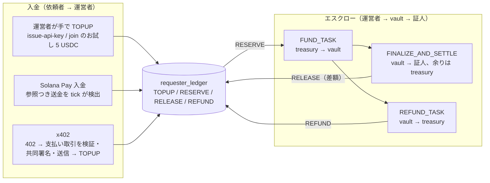

# 06. 決済設計: 前払い残高と x402 の 2 本立てを保ち、上限と見積もりを足す

作成: 2026-10-14 ／ 正本は 15 章（メインネットと SOL）、16 章（多通貨と処理量、PR #39〜#42 で審査中）

## 1. 目的

指示書 4.1 と 4.3 のうち決済に関わる部分（依頼者がどう払い、証人がどう受け取り、運営者がどう帳尻を合わせるか）を設計する。エスクローの内側は 05 章、支出の歯止めは 08 章に分け、この章は資金の流れと処理量を扱う。

## 2. 現状

資金の流れは次の 3 段で、「支払い」と「報酬のエスクロー」を分ける既存の決まり（`architecture.md` 6 節）を守っている。

入金のうち Solana Pay は、credential ごとに作った ed25519 の参照鍵を送金に付けてもらう。tick は参照を持つ credential を 25 件ずつ順に `getSignaturesForAddress` で見て、finalized の送金を `deposits` に 1 行ずつ記録する。x402 は `POST /v1/x402/verifications` で、通貨は USDC だけ、額は `bounty.amount × required_witnesses` に固定で、支払いごとに新しい API キーを返す。

証人への支払いは `settle` 1 回で行い、USDC は証人の ATA（無ければ operator が作る）、SOL は財布へ直接送る（wSOL を task 口座経由で lamports に戻す、15 §3.1）。手数料と rent は operator が持つ。プラットフォーム手数料の列（`platform_fee_amount`、移行 0027）はあるが、値は 0 で読む処理もない。円での受け取りは希望の登録だけで、支払いは始めていない。

処理量は 16 §2.3 で問題になり、メインネットの finalized 待ち（公開 RPC で約 7 秒）では 1 件ずつ直列に流す今の tick が 300 秒に収まらない見込みである。PR #40 で並列化（既定 6 並列、1 回 60 件、200 秒で新規の取り出しを止める）と送信の改善を入れたが、本番での実測はまだない。

## 3. 要件

- 依頼者の支出が、残高・1 件の上限・1 日の上限の 3 つで抑えられること（上限は null で無効にできる）
- 支払いの前に費用が分かること（04 章の見積もり）
- 運営者が、チェーンの支払いと DB の記録を日次で突き合わせられること
- メインネットの処理量が計測され、目標値（16 §7.1）と比べられること

## 4. 提案する設計

### 4.1 支出ポリシーの置き場

04 §4.3 のとおり `createVerification` に入れる。検査の順番は、ポリシー（種別・場所・締切）→ 1 件の上限 → 1 日の累計 → 残高とし、エラーコードは既存のものを使う。x402 の下見（402 を返す前に作成を試す）もこの順番を通るので、上限を超える依頼は払う前に断られる。

### 4.2 日次の突き合わせ

点検記録 7 項が勧める「`TaskSettled` の `paid_total` と `payment_records` の照合」を tick の 1 日 1 回の段（保持期限の削除と同じ段）に入れる。前日に CONFIRMED になった `payment_records` ごとに Task 口座を読み、`paid_total` と `recipients` が DB と一致するかを数え、違いがあれば警告ログと `audit_events`（`operator_action` ではなく新しい `reconciliation_mismatch`）に残す。RPC の呼び出しは 1 件 1 回なので、1 日 100 件なら 100 回で済む。

### 4.3 処理量の計測

PR #40 の並列化が入ったあと、tick の戻り値に段ごとの所要時間と件数を含め、`/v1/health/ready` が「直近の tick が 200 秒を超えたか」を見る。目標値は 16 §7.1 のまま（50 件の一括依頼の資金化が 5 分以内、確定から支払いまで 2 分以内）で、メインネット移行後の最初の 1 週間で実測し、`docs/ops/` に記録する。実測が目標に届かなければ、Vercel の関数ではなく Supabase の pg_cron から複数の tick を並べて呼ぶ（`JOB_CONCURRENCY` を上げるより、関数の 300 秒上限を 2 本に分けるほうが効く。推測）。

### 4.4 変えないこと

前払い残高の方式（D-05）、x402 を USDC に限ること（16 §9）、プラットフォーム手数料 0、円での支払いを始めないこと。いずれも法務（D-05、`legal-checklist.md` §3・§7）が片付くまで動かさない。

## 5. 技術選定の理由

突き合わせを tick に入れるのは、新しい常駐プロセスを持たないためで、1 日 1 回なら Vercel の関数の中で終わる。処理量の計測を `/v1/health/ready` に出すのは、外からの監視（`uptime.yml`）がすでにそれを 5 分ごとに見ているからで、警告の経路を増やさずに済む。

## 6. 代替案

- x402 を USDT や PYUSD に広げる案。`exact` 方式は SPL トークンの送金なので技術的には可能で、PR #41 の通貨台帳があれば mint の切り替えは小さい。需要が見えてから（16 §9）
- 入金の検出を Helius の Webhook（アドレスの監視）に替える案。tick の `getSignaturesForAddress` を減らせるが、Webhook の受け口と署名検証が増える。依頼者が 100 を超えてから検討する
- 証人への支払いをまとめて日次で行う案（G-11 の P2）。証人の公開鍵が依頼ごとに Explorer に出る問題を解くが、エスクローの「1 依頼 1 取引」という証明の形が崩れる。メインネット移行後に別途設計する

## 7. セキュリティ上の考慮事項

08 §1.5 の表のとおり二重支払いは 3 層で防いでいる。足す突き合わせは検出であって予防ではないが、鍵の濫用（点検記録 1 項）や DB とチェーンのずれを翌日には見つけられる。x402 の再送防止は `x402_payments` の主キー（取引 ID）で、120 秒を超えて送信中のままの行は送り直せるが、送り直す前にチェーン上の有無を確かめる。

## 8. 実装上の課題

- 日次の突き合わせは Task 口座を読むので、settle から 1 年以上たった依頼（保持期間 365 日）では `payment_records` が消えている。前日分だけを対象にすれば問題にならない
- `/v1/health/ready` の判定を増やすと `uptime.yml` が失敗する回数が増えうる。処理量の警告は 503 ではなく本文のフィールドに出し、503 は DB と tick の生死だけにする

## 9. テスト方針

突き合わせは `apps/web/test/jobs.test.ts` に、偽のチェーンアダプタが DB と違う `paid_total` を返す 1 件を足して警告が出ることを確かめる。処理量は単体テストでは測れないので、localnet で 50 件の資金化を流して所要時間を記録する手順を 09 章（既存仕様）の F 層に足す。

## 10. 未決定事項

- 16 §9 の 4 件（最初に開く通貨、発行元への信頼、証人の口座代、x402 の通貨）
- 処理量の目標が届かないときに pg_cron で tick を複数呼ぶか、別の実行基盤に移すか
- プラットフォーム手数料をいつ、どの通貨で取るか（`docs/pitch/08-revenue-model.md`）
