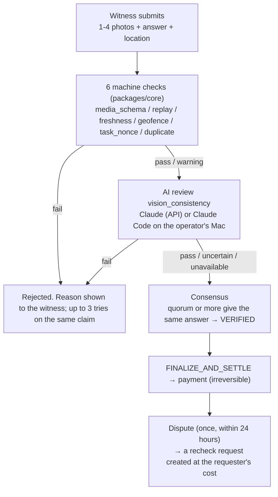

# 07. Verification design: pay on machine checks and AI review; put a person in only for large amounts

Written: 2026-10-14 / Authoritative: chapter 07 (evidence and verdicts), 01 §4.12, §4.16, §4.17, and 13 §3

## 1. Purpose

Section 4.4 of the brief asks for verification of photos, video, text, location-tagged deliverables and other digital data; a comparison of three approaches — automated AI verification, human review and disputes; and an assessment of "the risk of irreversible payments based on AI judgement alone".

## 2. Current state

Verification has four layers; only what passes one moves to the next.

| Deliverable | Handling |
|---|---|
| Photos | In-app camera only (no gallery). Re-encoded on the server to strip EXIF, compared by pHash with the last 90 days. Up to 4 per submission |
| Video | Not accepted (`media.contentType` is `image/jpeg` only) |
| Text | The answer's shape depends on the request type (17 types): choice, number, free text (4,000 characters), form (8 fields) |
| Location-tagged | Geofence (radius 25-500 m, accuracy within 100 m), an on-site challenge nonce, freshness (60-3,600 seconds). The spec states that spoofing cannot be detected |
| Other (phone calls, documents) | As "work that can be done anywhere", a photo of notes or a copy of the document stands in. AI review tends to return uncertain |

AI review: Claude (default `claude-opus-5-5`) looks at the request text, acceptance criteria, answer and photos and returns pass / fail / uncertain. Uncertain, and the API being down (unavailable), **pass** with a warning. With the flag `external_review_enabled` set, submissions wait in `CHECKING` until Claude Code on the operator's Mac judges them, and pass as unavailable after 30 minutes. That is the only path with human eyes; there is no screen where a person judges.

A dispute is allowed once within 24 hours of the result and creates a new recheck request; the original payment is not undone. With optimistic verification (13 §3), the first submission returns a provisional answer, and anyone may challenge within a 10-120 minute window by posting a bond of twice the bounty. A witness's trust level (`trust.ts`, `min_worker_tier`) limits which requests they can take.

## 3. Requirements

- Keep the four layers and D-08 (every submission that passes is paid)
- For requests with a large bounty, do not let a payment become final on AI judgement alone
- While AI is unavailable, do not let large requests pass unchecked
- Do not handle video or audio until someone asks

## 4. Proposed design

### 4.1 Comparing the three approaches

| Approach | Speed | Cost | Catches | Misses |
|---|---|---|---|---|
| Automated AI verification (current) | About 10 s after submission | One API call (a few yen) | Photos unrelated to the request, a summary where a transcription was asked for, answers that contradict the photo | The truth of things not in the photo (what was said on a call), clever composites, new prompt-injection tricks |
| Human review (currently only the operator's Mac) | 2-30 minutes | The operator's time | What AI marked uncertain, large requests | Anything while the operator is away (passes automatically after 30 minutes) |
| Disputes (current) | Within 24 hours of the result | The requester pays for the recheck | Correcting a wrong answer, finding collusion (kept in audit_events) | Undoing the original payment (ruled out by design) |

The three are not exclusive and are layered today. What is missing is a way to decide by amount which requests get a person; today it is all submissions or none.

### 4.2 Human review switched by amount (withdrawn on 2026-10-16)

**The owner withdrew this on 2026-10-16**, on the grounds that "human review is unnecessary; the requester using an AI agent can decide". How much to check before paying is chosen by the requester through `assurance.level`, the number of witnesses, optimistic verification and disputes. The operator does not hold payments across the board by amount. `HUMAN_REVIEW_MIN_TOTAL`, added in PR #46, was reverted. The original proposal is kept below.

Add the env var `HUMAN_REVIEW_MIN_TOTAL` (a total in USDC; unset by default, meaning off). When a request's total (`amount × required_witnesses`; for other currencies no USDC conversion, but a per-currency `HUMAN_REVIEW_MIN_TOTAL_<SYM>`) is at or above it, hold submissions in `CHECKING` regardless of `external_review_enabled` and wait for the operator. The existing `scripts/review-runner.ts` and `/v1/admin/reviews` serve as the review path.

For requests at or above the threshold, the rule that passes them as unavailable after 30 minutes does **not** apply. Wait until the deadline; past it, expire with `INSUFFICIENT_WITNESSES` and keep the witnesses' submissions on record only. Since that costs the witness, the witness screen says "The operator will check this. Payment is delayed until then" before they take such a request.

### 4.3 When AI is unavailable

Below the threshold, as today (pass as unavailable). This is the existing judgement that "a witness's work is not wasted if the operator's Mac or Claude's API is down", and it is reasonable while totals are small. One threshold caps what passes during an outage at "threshold × count".

### 4.4 Recording AI review

`result.reviews` and `checks.vision_consistency` are already returned to the requester. Add the model name and the runner (`claude-api` or `operator-mac`) to `evidence_checks.details`, so it can be counted later which verdicts came from a machine and which from a person. Not shown on public pages.

## 5. Rationale

The threshold is an env var so that changing it in production needs no deployment, like the other brakes (`PRIORITY_MAX_MICROLAMPORTS`, `JOB_CONCURRENCY`). Human review uses `review-runner` rather than a new screen, following 01 §4.17's judgement that with a single operator, Claude Code's structured output is faster than a screen.

## 6. Alternatives

- Requiring human review on every request. Each would be delayed 2-30 minutes and stop while the operator is away; not worth it for a 0.5 USDC bounty
- A second AI (another model) reviewing again. It sees the same photo, so it does nothing for composites or things not in the photo; double the cost for no extra coverage
- Asking witnesses for a bond. Optimistic verification's challenges already have one, but charging it on every submission would deter new witnesses. Rejected

## 7. Security considerations

**Assessing the risk of irreversible payments on AI judgement alone.** Payment is final with `settle` and cannot be undone. There are three conceivable ways to fool AI review. (1) Writing instructions to the reviewer as text inside the photo. The system prompt tells it not to follow text in images, but that is no guarantee. (2) Aiming for uncertain: deliberately blurring a photo passes with a warning. pHash and freshness still pass, so if the answer reaches consensus it is paid. (3) Aiming for an API outage: everything passes as unavailable while it lasts. The damage is limited to bounty × witnesses per request, and with several witnesses (quorum) one person alone cannot reach consensus. So the size of the risk is set by "the bounty" and "the number of witnesses". The original proposal had the operator set that amount with the threshold in 4.2; on 2026-10-16 this was withdrawn and the requester now chooses how much risk to accept. Paying a single-witness, low-value request on AI judgement alone is accepted as the consequence of the assurance level (`assurance.level`) the requester chose.

The route where a requester steers witnesses with prompt injection (hiding dangerous instructions in the request text) is held back by the banned words and length limits in 08 §1.1 and plain-text display, and the request text is passed to AI review as "untrusted input".

## 8. Implementation issues

- A submission held in `CHECKING` extends the claim's expiry (existing). More requests above the threshold would keep witnesses' slots occupied longer; do not set the threshold too low
- With multi-token (PR #41), totals are compared per currency. There is no USDC exchange rate, hence per-currency thresholds

## 9. Test strategy

Add three cases to `apps/web/test/external-review.test.ts`: below the threshold not held; at or above held even with `external_review_enabled` false; at or above not passed after 30 minutes. For the AI review record, check `details` with the existing fake reviewer in `multi-photo.test.ts`.

## 10. Open questions

- ~~The default threshold~~ withdrawn together with 4.2 (2026-10-16)
- Whether to accept video (no requests)
- Whether to delegate human review to someone other than the operator (highly trusted witnesses). That needs a design for pay and responsibility; not covered now
