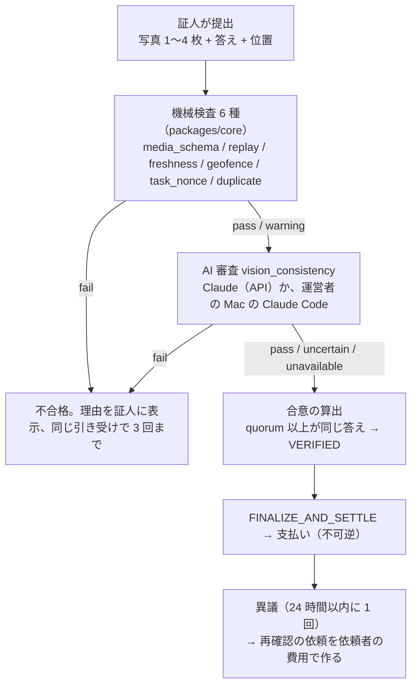

# 07. 成果物検証設計: 機械検査と AI 審査で払う。高額だけ人を挟む

作成: 2026-10-14 ／ 正本は 07 章（証拠と判定）、01 §4.12・§4.16・§4.17、13 §3

## 1. 目的

指示書 4.4 が求める、写真・動画・テキスト・位置情報つき成果物・その他のデジタルデータの検証と、AI による自動検証・人による確認・異議申し立ての 3 方式の比較、そして「AI の判定結果だけで不可逆な支払いを行うことのリスク」の評価を行う。

## 2. 現状

検証は 4 層で、順に通ったものだけが次へ進む。

| 成果物の種類 | 扱い |
|---|---|
| 写真 | アプリ内カメラのみ（ギャラリー不可）。サーバーで再エンコードして EXIF を落とし、pHash で 90 日分と比べる。1 提出に 4 枚まで |
| 動画 | 受け付けない（`media.contentType` は `image/jpeg` のみ） |
| テキスト | 答えの形は依頼の種類（17 種）で決まる。選択肢、数値、自由記述（4,000 字）、フォーム（8 項目） |
| 位置情報つき | geofence（半径 25〜500 m、精度 100 m 以内）、現地のチャレンジ nonce、鮮度（60〜3,600 秒）。偽装は検出できないと明記 |
| その他（電話、書類） | 「どこでもできる仕事」として、写真はメモや書類の写しで代替。AI 審査が uncertain を返しやすい |

AI 審査は Claude（既定 `claude-opus-5-5`）が依頼文・受け入れ条件・答え・写真を見て pass / fail / uncertain を返す。uncertain と、API が落ちているとき（unavailable）は warning つきで**合格**にする。フラグ `external_review_enabled` を立てると、提出は運営者の Mac の Claude Code が判定するまで `CHECKING` で止まり、30 分を過ぎると unavailable として通る。人の目が入る経路はこれだけで、画面で人が判定する仕組みはない。

異議は確定後 24 時間以内に 1 回、再確認の依頼を新しく作る形で、元の支払いは取り消さない。楽観的な確認（13 §3）は、最初の提出で仮の答えを返し、10〜120 分の異議期間に報酬の 2 倍の保証金で誰でも異議を出せる。証人の信頼度（`trust.ts`、`min_worker_tier`）で引き受けられる依頼を絞る。

## 3. 要件

- 既存の 4 層と、D-08（判定を通った提出にはすべて払う）を保つ
- 報酬が大きい依頼では、AI の判定だけで支払いが確定しないようにする
- AI が使えない間に、高額の依頼が確認なしで通らないようにする
- 動画と音声は、要望が出るまで扱わない

## 4. 提案する設計

### 4.1 3 方式の比較

| 方式 | 速さ | 費用 | 防げるもの | 防げないもの |
|---|---|---|---|---|
| AI による自動検証（現行） | 提出から約 10 秒 | API 1 回（数円） | 依頼と無関係な写真、要約で済ませた書き起こし、写真と矛盾する答え | 写真に写っていないことの真偽（電話の内容）、巧妙な合成、プロンプトインジェクションの新手 |
| 人による確認（現行は運営者の Mac のみ） | 2 分〜30 分 | 運営者の時間 | AI が uncertain にしたもの、高額の依頼 | 運営者が不在の間（30 分で自動的に通る） |
| 異議申し立て（現行） | 確定後 24 時間以内 | 依頼者が再確認の費用を持つ | 間違った答えの訂正、共謀の発見（audit_events に残る） | 元の支払いの取り消し（設計で否定） |

3 つは排他ではなく、いまも重ねて使っている。足りないのは「どの依頼に人を挟むか」を額で決める仕組みで、いまは全提出か 0 かの二択である。

### 4.2 額で切り替える人の審査

環境変数 `HUMAN_REVIEW_MIN_TOTAL`（USDC 建ての総額、既定は未設定＝無効）を足す。依頼の総額（`amount × required_witnesses`、多通貨なら USDC 換算は行わず通貨ごとの `HUMAN_REVIEW_MIN_TOTAL_<SYM>`）がこれ以上のとき、`external_review_enabled` の値にかかわらず提出を `CHECKING` で止め、運営者の審査を待つ。既存の `scripts/review-runner.ts` と `/v1/admin/reviews` がそのまま審査の経路になる。

この閾値以上の依頼では、30 分で unavailable として通す規則を**適用しない**。締め切りまで待ち、締め切りを過ぎたら `INSUFFICIENT_WITNESSES` で期限切れにし、証人の提出は記録だけ残す。証人の損になるので、閾値以上の依頼は証人の画面に「運営者の確認があります。確認までお支払いが遅れます」と表示し、引き受ける前に知らせる。

### 4.3 AI 障害時の扱い

閾値未満の依頼は今のまま（unavailable で合格）。これは「運営者の Mac や Claude の API が止まっても証人の仕事を無駄にしない」という既存の判断で、総額が小さい間は妥当である。閾値を 1 つ設けることで、障害の間に通る金額の天井が「閾値 × 件数」に決まる。

### 4.4 AI 審査の記録

`result.reviews` と `checks.vision_consistency` はすでに依頼者に返る。足すのは、審査に使ったモデル名と実行者（`claude-api` か `operator-mac`）を `evidence_checks.details` に残すことで、後から「どの判定が機械で、どれが人か」を数えられるようにする。公開ページには出さない。

## 5. 技術選定の理由

閾値を環境変数にしたのは、本番で値を変えるのに配置が要らないためで、他の歯止め（`PRIORITY_MAX_MICROLAMPORTS`、`JOB_CONCURRENCY`）と同じ扱いになる。人の審査に新しい画面を作らず `review-runner` を使うのは、運営者が 1 人で、画面より Claude Code の構造化出力のほうが速いという 01 §4.17 の判断に従う。

## 6. 代替案

- すべての依頼に人の審査を必須にする案。1 件あたり 2〜30 分遅れ、運営者の不在で止まる。報酬 0.5 USDC の依頼に見合わない
- 第二の AI（別のモデル）で二重に審査する案。同じ写真を見るので、合成や写っていないことの真偽には効かない。費用が倍になる割に防げるものが増えない
- 証人に保証金を求める案。楽観的な確認の異議にはすでにあるが、提出そのものに課すと新しい証人が入りにくい。退ける

## 7. セキュリティ上の考慮事項

**AI の判定だけで不可逆な支払いをする危険の評価。** 支払いは `settle` で確定し、取り消せない。AI 審査を欺く経路は 3 つ考えられる。(1) 写真の中の文字で判定の指示を書く。システムプロンプトは画像内の文字に従わないよう指示しているが、保証ではない。(2) uncertain を狙う。写真を意図的にぼかすと warning つきで通る。機械検査の pHash と鮮度は通るので、答えが合意に達すれば払われる。(3) API 障害を狙う。障害の間はすべて unavailable で通る。これらの被害は 1 件あたり報酬 × 証人数に限られ、複数の証人（quorum）があれば単独では合意に達しない。したがって危険の大きさは「報酬の額」と「証人の数」で決まり、4.2 の閾値はその額を運営者が決められるようにする。1 証人・低額の依頼で AI の判定だけで払うのは、依頼者が選んだ保証の水準（`assurance.level`）の帰結として受け入れる。

依頼者がプロンプトインジェクションで証人を誘導する経路（依頼文に危険な指示を隠す）は、08 §1.1 の禁止語と文字数制限、プレーンテキスト表示で抑えており、AI 審査にも依頼文を「信用しない入力」として渡している。

## 8. 実装上の課題

- `CHECKING` で止まった提出はクレームの有効期限を延ばす（既存）。閾値以上の依頼が増えると、証人の引き受け枠が長く埋まる。閾値は低くしすぎない
- 多通貨（PR #41）が入ると総額の比較が通貨ごとになる。USDC 換算の相場を持たないため、通貨ごとの閾値にする

## 9. テスト方針

`apps/web/test/external-review.test.ts` に、閾値未満は止まらない、閾値以上は `external_review_enabled` が false でも止まる、閾値以上は 30 分で通らない、の 3 件を足す。AI 審査の記録は `multi-photo.test.ts` の既存の偽レビュアーで `details` を確かめる。

## 10. 未決定事項

- 閾値の既定値（5 USDC 総額を提案。本番の報酬の分布を読んでから決める）
- 動画を受け付けるか（要望なし）
- 人の審査を運営者以外（信頼度の高い証人）に委ねるか。報酬と責任の設計が要るので今回は扱わない
