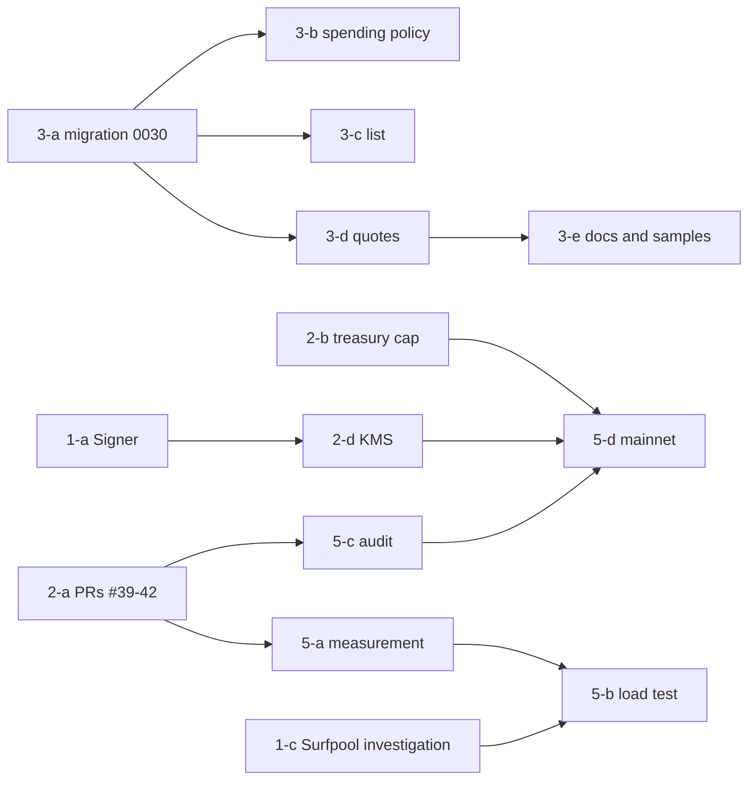

# 11. Implementation roadmap: most of Phases 2-4 is done; what remains is brakes and production operations

Written: 2026-10-14 / **Implementation waits for approval of this document.** No code changes until then

## 1. Purpose

Split Phases 1-5 of section 7 of the brief into "done" and "remaining" against chapter 01's ratings, and for what remains give the work, dependencies, difficulty and done criteria. Difficulty has three levels: small (one PR, half a day), medium (1-2 PRs, 1-2 days), large (several PRs or arrangements with outside parties).

## 2. Current state

The brief's phases mapped to the implementation:

| Phase | Brief | State |
|---|---|---|
| 1 Groundwork | Review the existing architecture, tidy the Solana SDK, improve wallet connection, unify the API spec | The review is done in these documents. The SDK is unified on web3.js v1 and Anchor. Wallets are Privy, with nothing to improve. The API spec is unified in OpenAPI |
| 2 Settlement | USDC escrow, deposit confirmation, releasing rewards, refunds, settlement tests | Implemented (Devnet). Remaining: mainnet operations and where keys live |
| 3 AI agent integration | Agent API, API key auth, creating requests, getting status, payment integration | Implemented. Remaining: list, quotes, spending policy |
| 4 Verifying deliverables | Uploads, AI verification, approve/reject, resubmission, disputes | Implemented (approve/reject left out by design). Remaining: human review by amount |
| 5 Production | Security audit, load testing, monitoring and logs, recovery, mainnet | Monitoring and recovery procedures are in spec 08 §5-6 and working. Audit, load testing and mainnet not done |

## 3. Requirements

For each phase, state the work, dependencies, difficulty and done criteria. Work that needs approval is listed as operator work.

## 4. Proposed design: remaining work

### Phase 1: groundwork (3 left)

| Work | Depends on | Difficulty | Done when |
|---|---|---|---|
| 1-a The Signer boundary (05 §4.1, migration stage M2) | Nothing. If PR #40 lands first, `send.ts` builds on it | Medium | `createAnchorAdapter` takes a `Signer`, and with `memory` all existing tests pass (web 243, solana unit tests, localnet 7). At least one test pins that bytes match before and after signing |
| 1-b The Codama-generated client (02 §4.2, M7) | Independent of 1-a | Small | `codama.json` and the generated code are in the repo, CI checks them against the IDL, and `packages/sdk/test/onchain.test.ts` passes |
| 1-c Investigating Surfpool (02 §4.1) | Nothing | Small (investigation only) | A record in `docs/` of whether it loads Anchor 1.2's `.so` and runs `initialize_task`. If it does, queue replacing the localnet tests in Phase 5 |

### Phase 2: settlement (4 left)

| Work | Depends on | Difficulty | Done when |
|---|---|---|---|
| 2-a Merging PRs #39-#42 and deploying v1.3 to Devnet (M0) | The operator merges and deploys | Medium (operator) | As in 12 §9a, `devnet-setup --test-mints` passes on Devnet and one funding and one payout pass for each currency in `ASSETS_ENABLED` |
| 2-b The treasury cap and warning (05 §4.3) | Nothing | Small | The tick logs a warning above the env vars `TREASURY_MAX_USDC` and `TREASURY_MAX_SOL`; one test |
| 2-c Daily reconciliation (06 §4.2, M6) | Nothing | Small | A mismatch between yesterday's CONFIRMED rows and Task accounts records `reconciliation_mismatch`; one test |
| 2-d A KMS backend (05 §4.1, M8) | 1-a, an operator contract | Large | A `keychain` backend round trip passes on Devnet, and production operator and verifier keys disappear from env vars |

### Phase 3: AI agent integration (5 left)

| Work | Depends on | Difficulty | Done when |
|---|---|---|---|
| 3-a Migration 0030 (chapter 09, M1) | Nothing | Small | Applied in production; `migrations.test.ts` passes |
| 3-b Spending policy and `x402_enabled` (04 §4.3, 08 §4.1 and §4.3, M3) | 3-a | Small | Exceeding a limit returns the existing error codes; null means no limit; with the flag false x402 returns 503. Four or more negative tests |
| 3-c List API (04 §4.1, M4) | 3-a | Small | `GET /v1/verifications` and MCP `list_reality_verifications` work and never show others' requests |
| 3-d Quote and confirm (04 §4.2, M4) | 3-a | Medium | `mode: "quote"` and `confirm: false` reserve nothing, and `quote_id` confirms. A different body gets 409. Expiry 5 minutes |
| 3-e Docs and samples (02 §4.5, §4.6, M9) | 3-d | Small | `/developers` says when the cost is reserved and recommends approval, and explains paying with Phantom MCP. `scripts/x402-agent.ts` shows the terms and waits for approval |

### Phase 4: verifying deliverables (2 left)

| Work | Depends on | Difficulty | Done when |
|---|---|---|---|
| 4-a Human review by amount (07 §4.2, M5) | Nothing | Small | Requests at or above `HUMAN_REVIEW_MIN_TOTAL` wait in `CHECKING` and do not pass after 30 minutes; the witness screen says so; three tests |
| 4-b Recording who reviewed (07 §4.4) | Nothing | Small | `evidence_checks.details` contains the model name and the runner |

### Phase 5: production (5 left)

| Work | Depends on | Difficulty | Done when |
|---|---|---|---|
| 5-a Measuring throughput (06 §4.3) | 2-a | Small | The tick returns per-step durations and `/v1/health/ready` shows the latest values. Record the time to fund 50 requests on localnet |
| 5-b Load testing | 5-a, 1-c | Medium | Measure the targets in 16 §7.1 (fund 50 within 5 minutes; final to paid within 2 minutes) on localnet or Surfpool and record in `docs/ops/` |
| 5-c Third-party audit (08 §4.4) | 2-a (after v1.3 deployment), arranged by the operator | Large (operator) | An audit report in `docs/security/`, with each finding fixed or a reason for accepting it |
| 5-d Moving to mainnet (15 §4.5, 12 §10) | 2-b, 2-d, 5-c (or a decision to proceed without an audit), operator work | Large (operator) | Startup passes the gate with `SOLANA_CLUSTER=mainnet-beta`, and a request of 1 USDC or less goes through funding, payout and refund |
| 5-e Updating recovery procedures | 2-d | Small | Add disabling the KMS key and stopping `x402_enabled` to the table in 08 §6 |

## 5. Rationale (ordering)

3-a to 3-c in Phase 3 are all small and only 3-b changes production behaviour, so putting them in first gets the brakes working early. 1-a in Phase 1 is a prerequisite for 2-d in Phase 2, which is a prerequisite for moving to mainnet (5-d). The shortest path is therefore 3-a → 3-b → 1-a → 2-b → 2-c → 2-d → 5-d, with the rest fitted in between.

Dependencies:

## 6. Alternatives

- Moving to mainnet before the KMS (2-d). The owner's decision (2026-10-13) brought the move forward, and proceeding with only the treasury cap (2-b) is possible. Then 2-d becomes post-move work and the ceiling on damage is the cap. The owner chooses
- Skipping the third-party audit. If skipped for cost and time, record the decision in a document, as in `docs/legal/2026-10-13-owner-decision.md`

## 7. Security considerations

3-b goes first so that, before real money moves on mainnet, spending by requesters whose identity is unknown (`/join`, x402) has a ceiling. 5-d includes the decision whether to wait for the audit in 5-c.

## 8. Implementation issues

- Each piece of work is sized so Claude Code can do it in one session (no subagents). To parallelise, split it as briefs in `docs/agents/`
- Operator work (2-a, 2-d, 5-c, 5-d) goes in the PR description as a procedure for the operator to follow
- PRs are merged by the operator after the three CI jobs pass (`gh pr merge` is blocked by the auto-mode classifier)

## 9. Test strategy

The tests in each done criterion run in CI. Load testing (5-b) and the KMS round trip (2-d) are not in CI; their procedure and results go in `docs/ops/`.

## 10. Open questions (for the owner)

**The owner decided on 2026-10-15:** (1) implementation may proceed; (2) spending limits default to no limit (null); (3) move to mainnet before the KMS, with the treasury cap as the ceiling on damage; (4) a human-review threshold of 5 USDC total (**withdrawn on 2026-10-16: no human review; the requester decides**); (5) no third-party audit; (6) add MCP tools (list and quotes); (7) build the ChatGPT widget; (8) open four currencies first — USDC, SOL, USDT, PYUSD — and add more later.

**Implementation status the same day** (PRs stacked #42 → #44 → #45 → #46 → #47):

| Work | Status |
|---|---|
| 3-a migration 0030, 3-b spending policy and `x402_enabled`, 3-c list, 3-d quotes, 3-e docs and samples | PR #44 |
| 1-a the Signer boundary, 2-b the treasury cap, 2-c daily reconciliation, 5-a throughput measurement (`tick_runs`, `last_tick`) | PR #45 |
| 4-a human review by amount (default 5 USDC), 4-b recording who reviewed | Added in PR #46, then reverted by the owner's decision of 2026-10-16 (07 §4.2) |
| The ChatGPT widget, 5-e additions to the recovery procedures | PR #47 |
| 1-c Investigating Surfpool | Done. The deployment binary and the settlement adapter's four instructions passed in 330 ms (`docs/ops/surfpool-spike-2026-10-15.md`). Finality is instant, so it cannot be used to measure throughput; queued for 5-b |
| 1-b The Codama-generated client | Not pursued. `packages/sdk/src/onchain.ts` reads account bytes directly without the IDL or an Anchor client, which is lighter than a generated client; there is no longer a reason to add `@solana/kit` |
| 2-a merging PRs #39-#42 and deploying v1.3 to Devnet, 2-d KMS, 5-b load testing, 5-c audit (not done), 5-d mainnet | Operator work, or after the move |

The eight questions below are kept as they were before the decision.

1. **Approve these documents and start implementing?** If so, start with 3-a → 3-b
2. Default spending limits to null (no limit), or enforce the 5 USDC / 20 USDC on `/join` and x402 keys as they are (M3)?
3. The KMS backend (AWS, GCP, Privy, Turnkey), and whether to move to mainnet before or after the KMS
4. ~~The default human-review threshold~~ withdrawn together with human review on 2026-10-16
5. Whether to get a third-party audit, and if so after deploying v1.3
6. Whether to add the list API and quotes as MCP tools (from 8 tools to 10)
7. Whether to build the ChatGPT widget (an extension of 3-e)
8. The four multi-token questions in 16 §9 (which currency first, trust in issuers, witnesses' account costs, x402 currencies)
