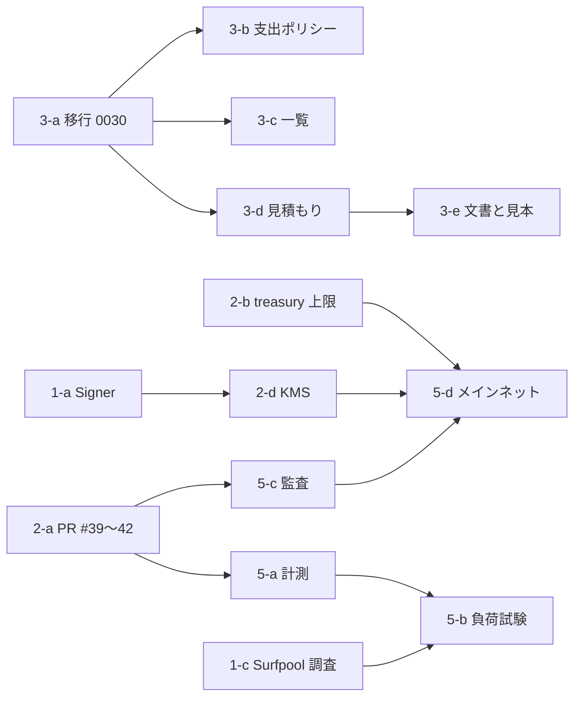

# 11. 実装ロードマップ: Phase 2〜4 の大半は済んでいる。残りは歯止めと本番運用

作成: 2026-10-14 ／ **実装はこの文書の承認を待つ。** 承認までコードは変えない

## 1. 目的

指示書第 7 節の Phase 1〜5 を、01 章の評価に照らして「済んだもの」と「残るもの」に分け、残るものについて作業・依存・難易度・完了条件を書く。難易度は、小（1 PR、半日）、中（1〜2 PR、1〜2 日）、大（複数 PR か外部の手配を伴う）の 3 段階とする。

## 2. 現状

指示書の Phase と実装の対応を先に示す。

| Phase | 指示書の内容 | 状態 |
|---|---|---|
| 1 基盤の整理 | 既存アーキテクチャの確認、Solana SDK の整理、ウォレット接続の改善、API 仕様の統一 | 確認はこの文書群で完了。SDK は web3.js v1 と Anchor で統一済み。ウォレットは Privy で改善の余地なし。API 仕様は OpenAPI で統一済み |
| 2 決済基盤 | USDC エスクロー、資金預入確認、報酬解放、返金処理、決済テスト | 実装済み（Devnet）。残るのはメインネットの運用と鍵の置き場 |
| 3 AI エージェント連携 | Agent API、API キー認証、依頼作成、依頼状況取得、支払い連携 | 実装済み。残るのは一覧、見積もり、支出ポリシー |
| 4 成果物検証 | アップロード、AI による検証、承認・却下、再提出、紛争処理 | 実装済み（承認・却下は設計で置かない）。残るのは額による人の審査 |
| 5 本番運用 | セキュリティ監査、負荷テスト、監視・ログ、障害復旧、Mainnet 対応 | 監視と障害手順は仕様 08 §5〜6 にあり動いている。監査、負荷テスト、Mainnet は未了 |

## 3. 要件

各 Phase に、作業、依存、難易度、完了条件を明記する。承認が要る作業は運営者の作業として分ける。

## 4. 提案する設計: 残る作業

### Phase 1: 基盤の整理（残り 3 件）

| 作業 | 依存 | 難易度 | 完了条件 |
|---|---|---|---|
| 1-a Signer の境界（05 §4.1、移行 M2） | 無し。PR #40 が先なら `send.ts` はその上で | 中 | `createAnchorAdapter` が `Signer` を受け、`memory` で既存のテスト（Web 243、solana の単体、localnet 7）が全て通る。署名前後のバイト列が一致するテストが 1 件以上ある |
| 1-b Codama の生成クライアント（02 §4.2、M7） | 1-a と独立 | 小 | `codama.json` と生成物がリポジトリにあり、CI が IDL との一致を確かめる。`packages/sdk/test/onchain.test.ts` が通る |
| 1-c Surfpool の調査（02 §4.1） | 無し | 小（調査のみ） | Anchor 1.2 の `.so` を読んで `initialize_task` が通るかの結果を `docs/` に記録。通れば localnet テストの置き換えを Phase 5 に積む |

### Phase 2: 決済基盤（残り 4 件）

| 作業 | 依存 | 難易度 | 完了条件 |
|---|---|---|---|
| 2-a PR #39〜#42 の取り込みと Devnet への v1.3 配置（M0） | 運営者のマージと配置 | 中（運営者） | 12 §9a のとおり Devnet で `devnet-setup --test-mints` が通り、`ASSETS_ENABLED` の通貨で資金化と支払いが 1 件ずつ通る |
| 2-b treasury の上限と警告（05 §4.3） | 無し | 小 | 環境変数 `TREASURY_MAX_USDC`・`TREASURY_MAX_SOL` を超えると tick が警告ログを出す。テスト 1 件 |
| 2-c 日次の突き合わせ（06 §4.2、M6） | 無し | 小 | 前日の CONFIRMED と Task 口座の不一致で `reconciliation_mismatch` が記録される。テスト 1 件 |
| 2-d KMS バックエンド（05 §4.1、M8） | 1-a、運営者の契約 | 大 | Devnet で `keychain` バックエンドの往復が通り、本番の operator と verifier が環境変数から消える |

### Phase 3: AI エージェント連携（残り 5 件）

| 作業 | 依存 | 難易度 | 完了条件 |
|---|---|---|---|
| 3-a 移行 0030（09 章、M1） | 無し | 小 | 本番に当たり、`migrations.test.ts` が通る |
| 3-b 支出ポリシーと `x402_enabled`（04 §4.3、08 §4.1・§4.3、M3） | 3-a | 小 | 上限超過が既存のエラーコードで返る。null は無制限。旗 false で x402 が 503。否定テスト 4 件以上 |
| 3-c 一覧 API（04 §4.1、M4） | 3-a | 小 | `GET /v1/verifications` と MCP の `list_reality_verifications` が動き、他人の依頼が出ない |
| 3-d 見積もりと確定（04 §4.2、M4） | 3-a | 中 | `mode: "quote"` と `confirm: false` が残高を引き当てず、`quote_id` で確定できる。本文違いは 409。失効 5 分 |
| 3-e 文書と見本（02 §4.5・§4.6、M9） | 3-d | 小 | `/developers` に「費用が引き当てられる時点」と承認の勧め、Phantom MCP での支払いの案内。`scripts/x402-agent.ts` が条件を表示して承認を待つ |

### Phase 4: 成果物検証（残り 2 件）

| 作業 | 依存 | 難易度 | 完了条件 |
|---|---|---|---|
| 4-a 額による人の審査（07 §4.2、M5） | 無し | 小 | `HUMAN_REVIEW_MIN_TOTAL` 以上の依頼が `CHECKING` で止まり、30 分で通らない。証人の画面に表示が出る。テスト 3 件 |
| 4-b 審査の実行者の記録（07 §4.4） | 無し | 小 | `evidence_checks.details` にモデル名と実行者が入る |

### Phase 5: 本番運用（残り 5 件）

| 作業 | 依存 | 難易度 | 完了条件 |
|---|---|---|---|
| 5-a 処理量の計測（06 §4.3） | 2-a | 小 | tick の戻り値に段ごとの所要時間が入り、`/v1/health/ready` の本文に直近の値が出る。localnet で 50 件の資金化の所要時間を記録 |
| 5-b 負荷試験 | 5-a、1-c | 中 | 16 §7.1 の目標（50 件の資金化 5 分以内、確定から支払い 2 分以内）を localnet か Surfpool で測り、`docs/ops/` に記録 |
| 5-c 第三者監査（08 §4.4） | 2-a（v1.3 配置後）、運営者の手配 | 大（運営者） | 監査報告が `docs/security/` にあり、指摘が修正されるか受け入れ理由が書かれている |
| 5-d メインネット移行（15 §4.5、12 §10） | 2-b、2-d、5-c（または監査なしで進む決定）、運営者の作業 | 大（運営者） | `SOLANA_CLUSTER=mainnet-beta` で起動の門を通り、1 USDC 以下の依頼が資金化・支払い・返金の 3 経路で通る |
| 5-e 障害復旧の手順書の更新 | 2-d | 小 | 08 §6 の表に KMS の鍵の無効化と、`x402_enabled` の停止を足す |

## 5. 技術選定の理由（順番の考え方）

Phase 3 の 3-a〜3-c は互いに小さく、本番の動作を変えるのは 3-b だけなので、最初にまとめて入れると歯止めが早く効く。Phase 1 の 1-a は Phase 2 の 2-d の前提で、2-d はメインネット移行（5-d）の前提である。したがって最短の道は 3-a → 3-b → 1-a → 2-b → 2-c → 2-d → 5-d で、残りはその間に挟む。

依存の図を示す。

## 6. 代替案

- メインネット移行を KMS（2-d）の前に行う案。オーナーの決定（2026-10-13）は移行を前倒ししており、treasury の上限（2-b）だけで進む道もある。その場合 2-d は移行後の作業になり、被害の天井は上限の値で決まる。選ぶのはオーナー
- 第三者監査を省く案。費用と期間を考えて省くなら、`docs/legal/2026-10-13-owner-decision.md` と同じ形で決定を文書に残す

## 7. セキュリティ上の考慮事項

Phase 3 の 3-b を先に入れる理由は、メインネットで実際のお金が動く前に、身元を知らない依頼者（`/join`、x402）の支出に天井を付けるためである。Phase 5 の 5-d は、5-c の監査を待つか、待たずに進むかの決定を含む。

## 8. 実装上の課題

- 作業はいずれも Claude Code が 1 画面で進められる大きさに分けた（サブエージェントは使わない）。並行させるなら `docs/agents/` の指示書の形で分ける
- 運営者の作業（2-a、2-d、5-c、5-d）は PR の本文に手順を書き、運営者が行う
- PR は CI の 3 ジョブが通ってから、運営者がマージする（`gh pr merge` は自動判定で止められるため）

## 9. テスト方針

各作業の完了条件に含めたテストを CI で回す。負荷試験（5-b）と KMS の往復（2-d）は CI に入れず、手順と結果を `docs/ops/` に残す。

## 10. 未決定事項（オーナーに決めてほしいこと）

1. **この文書群を承認し、実装を始めてよいか。** 始めるなら 3-a → 3-b から
2. 支出上限の既定を null（無制限）にするか、`/join` と x402 のキーの 5 USDC・20 USDC をそのまま効かせるか（M3）
3. KMS のバックエンド（AWS、GCP、Privy、Turnkey）と、メインネット移行を KMS の前に行うか後に行うか
4. 人の審査の閾値の既定値（提案は総額 5 USDC）
5. 第三者監査を受けるか、受けるなら v1.3 の配置後か
6. 一覧 API と見積もりを MCP の道具に足すか（道具が 8 本から 10 本に増える）
7. ChatGPT のウィジェット（3-e の延長）を作るか
8. 16 §9 の多通貨の 4 件（最初に開く通貨、発行元への信頼、証人の口座代、x402 の通貨）
