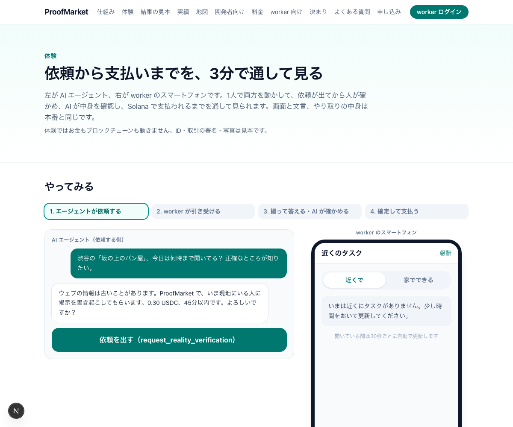
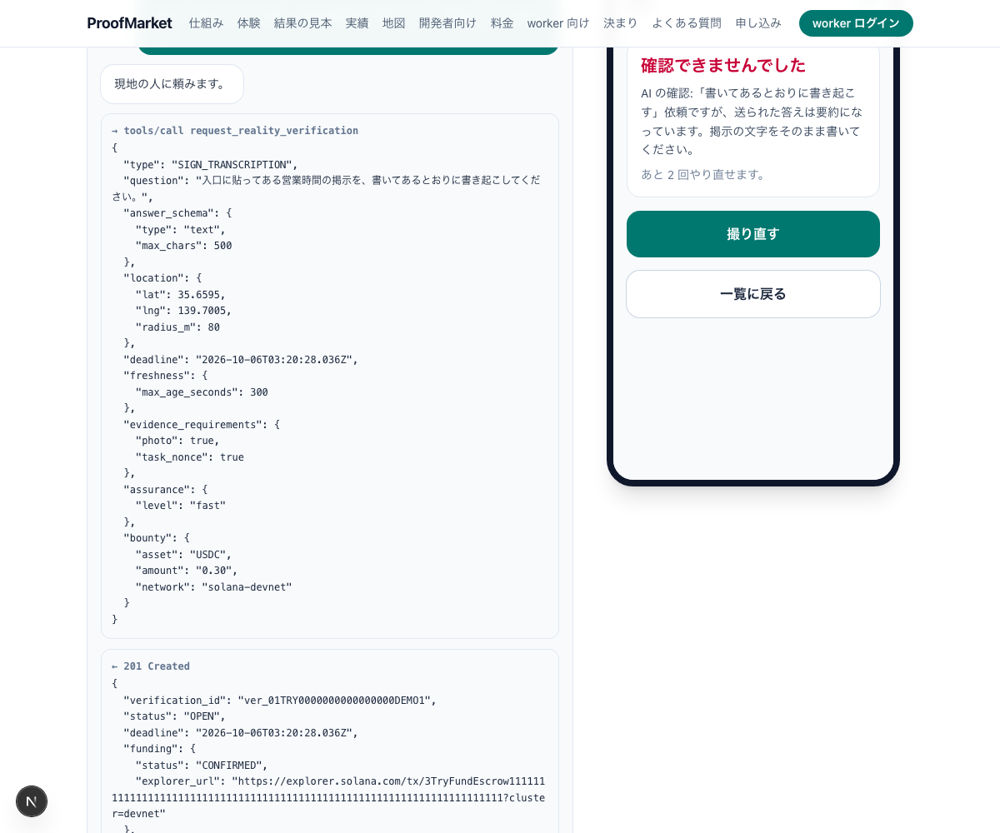
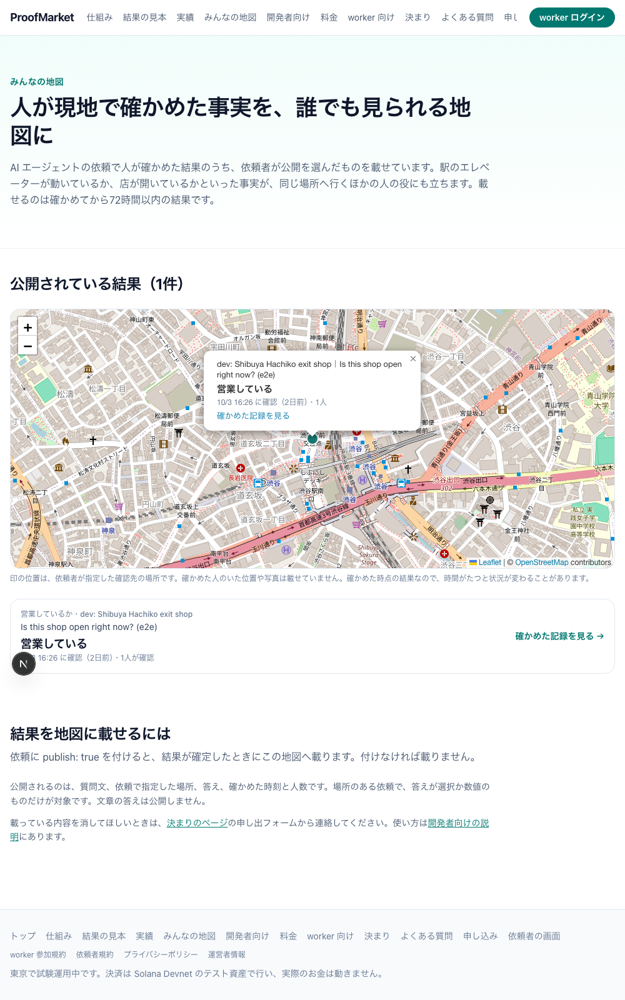

# Abstract

AI agents can read the web, but they cannot go and see whether a shop is open right now, read a paper notice, or make a phone call. This report records **ProofMarket**, a system that fills that gap with human hands and returns the answers after machines have verified them, taken from design to production operation in the five days from October 2 to October 6, 2026.

What was built comes down to four things. First, an API through which an agent requests "something it wants a person to check" and receives the result as structured JSON. There are three entry points: MCP (Model Context Protocol, a common standard for AI apps to call external tools), plain REST, and x402, which uses HTTP's 402 response to request in exchange for payment. There are 17 request types, from shop-front checks to transcribing paper records and making phone inquiries. Second, screens where workers take requests using only their phone's browser and send photos taken with the in-app camera plus their answers. Third, besides mechanical checks on every submission (place, time, passphrase, reuse), a content check in which Claude compares the photo and answer with the request. Submissions that do not match the request are sent back with a reason. Fourth, settlement — holding the reward, recording the result hash and paying the worker (the person answering the request) — done by our own program on Solana's test network (Devnet). The currency is USDC (test), a dollar-pegged stablecoin.

Production runs at https://proofmarket.fun. The code is about 28,000 lines of TypeScript and Rust, with 214 automated tests, 29 API operations, 21 database migrations and 13 spec documents. On October 5, the x402 flow — an agent without an API key paying USDC to place a request — was run end to end in production. A PR (pull request) in this report is a unit of change merged per feature after review and automated checks.

The limits of the evaluation are clear. Workers are invite-only and few, and the number of real requests is still at trial level. Settlement uses test USDC on Devnet, and verdicts are made with a single operator key. So what this report can show is "the system works as designed"; "it works as a market" remains future work.

# 1. The problem: agents cannot see "here and now" facts

One reason AI agents give wrong answers is that fresh, location-bound evidence is unavailable to them. It is not a problem of intelligence. Search can return information months old; an inventory API can say "in stock" while the shelf is empty. Existing photos cannot tell whether a shop is open now, because nothing guarantees where and when they were taken.

Markets for asking people to do work already exist (RentAHuman, Taskin, NeedaHuman and others appeared in 2026). What is missing is what happens after asking. The requesting agent cannot judge whether the photo that arrived is really of that shop, or whether every requested item is included. Lacking the material to judge, either a person reviews it or it is used unchecked.

So the question this project set out to answer was:

> Can we build a system in which an agent asks, in a standard form, for "something it wants a person to check", machines verify the freshness and location of the evidence that arrives, several people's answers are combined, and the result is received in machine-readable form? And if we build it, will people take part?

To the first half, "can we build it", this report can answer yes. The second half, "will people take part", has no answer yet.

# 2. Design: return not just the answer but "the reasons to trust it"

## 2.1 From request to payment in four stages

A request moves through four stages: request, work, verification, settlement (Figure 1).

When requesting, the agent specifies the question, the answer format (choices, a number, text), a place (optional), a deadline, the reward, and how many matching answers finalize the result (the quorum). When the request is created, the reward is deposited into escrow on Solana. Neither the operator nor the requester can move it until there is a result.

Workers see nearby requests, or requests that need no place, in a list and take one. A claim has 30 minutes, and on arriving on site the capture window (5 minutes by default) starts. Photos can only be taken with the in-app camera, not picked from the phone's album.

Submitted photos and answers are first checked mechanically on six items: taken at the specified place (geofence), within the window, containing the one-time passphrase (nonce) issued for this request, and free of reuse of past photos or close resemblance to other workers' photos. Only submissions that pass everything go on to the AI content check.

When answers reach the quorum, the result is finalized, and in the same transaction the result and evidence hashes are recorded on Solana and the workers are paid in USDC. The agent receives, together with the answer, the result of each check, the AI's verdict and reasons, how many answers agreed, and the Solana transaction signature, as JSON.



## 2.2 The AI content check decides submission quality

Mechanical checks only go as far as "a photo taken at the right place, now, for this request". Whether what the photo shows answers the question is a separate matter. A summary arriving when a transcription was requested, or a shop-front photo arriving when a price tag was requested, gets past mechanical checks.

So for every submission, Claude receives the request type, question, answer format, answer and a downscaled photo, and judges in three grades whether it matches the request. `pass` is accepted; `fail` is sent back (the worker can retry up to 3 times within the same claim); `uncertain` (a blurry photo, or something like a phone call that a photo cannot confirm) is accepted with a warning. The verdict and reason go back to the requester, and the verdict's status also goes into the result hash.

Figure 2 shows a worker who sent a summary being sent back. The reason is shown in the worker's language, along with the remaining attempts.



In production, content checks run without an API contract: the operator's subscribed Claude Code runs on a Mac every 2 minutes (spec 01 §4.17). In this setup, checks stop if the Mac stops, so a submission with no verdict within 30 minutes passes with a warning as "could not be checked". This keeps workers' completed work and requesters' deadlines from depending on whether the Mac is running (changed on October 6).

## 2.3 Solana is used so things can be checked without trusting the operator

There are three reasons to use a blockchain.

The first is escrow. When the request is made, the reward is deposited into an account of our own program (written in Anchor, a development framework for Solana), and nobody can move it until the result is final. Workers need not doubt that they will be paid.

The second is recording the result. The hash of the finalized result (`result_hash`) and of the evidence (`evidence_root`) are written in the same transaction as the payment. If the operator later rewrote a result, it would contradict the on-chain record. The public result page reads the Solana account directly from the browser and checks on the spot that it matches the result shown.

The third is small instant payments. A request pays 0.1–0.5 USDC (tens of yen), and paying people per request needs a chain with low fees and fast settlement. Workers use a wallet created automatically at login (an embedded wallet from the authentication service Privy), and the operator covers SOL fees, so no crypto knowledge is needed.

x402 extends this. When an agent with a Solana wallet sends a request, the server returns HTTP 402 with payment requirements. The agent signs a USDC transfer and sends again, and the server creates the request after the transaction is confirmed. No sign-up, no API key, no invoice. It demonstrates, in working form, "an agent paying a person on the spot from its own wallet".

Only hashes and payments go on chain. Photos, exact locations, questions and text answers do not. This protects personal information; the flip side is that checking the contents relies on the operator's database. Section 5 treats this as a limitation.

## 2.4 Design for people: work from home, and a shared map

The initial target was "checks in front of shops", but on October 4 it widened to all "work that needs a human hand, which AI cannot do itself". There are now 17 request types, of which 7 (transcribing paper records, reading records and answering, inspecting physical items, phone inquiries, measurement, questions with requester-defined choices, and other work) need no particular place.

Requests that need no place become work for people who find it hard to go out. On October 5, a toggle between "nearby" and "from home" was added to the worker list, and "from home" asks for no location at all. Before that, the list itself could not be seen without allowing location.

Checked facts help more than the requester. Requests marked `publish: true` appear on the public map (`/map`) for 72 hours after finalization (Figure 3). One paid request, "this station's elevator is working", helps the next person heading there for free. Only the question, place, answer, time and number of people are published; photos and worker information are not.



When an agent answers a user, it attaches a "checked by people" proof link and badge (Figure 4). Users can see for themselves when, by how many people and through which checks it was confirmed, and the Solana record.


# 3. Implementation: 13 specs, about 28,000 lines of code and 51 PRs in five days

## 3.1 Architecture: everything except the Solana program is off-the-shelf

| Layer | Technology | Main contents |
|---|---|---|
| Web and API | Next.js 16, TypeScript | Public site (Japanese and English), worker app, REST API with 29 operations, MCP server (7 tools, OAuth 2.1 authorization) |
| Data | PostgreSQL (Supabase), Drizzle | 34 tables, 21 migrations, row-level security enabled on every table |
| Chain | Solana Devnet, Anchor (Rust) | Escrow, result recording and payment in one program |
| Payment entry | x402 v2 (exact SVM scheme) | The operator acts as both facilitator and fee payer |
| Content check | Claude (claude-opus-5-5) | A verdict per submission; in production run from launchd on the operator's Mac |
| Authentication | Privy | Worker login and embedded wallets |
| Delivery | Vercel | Published automatically on merge to main |

By size: about 18,000 lines for web and API, about 3,300 for shared types and rules, about 2,000 for the Solana connection, about 2,100 for the Rust program and about 1,000 for operational scripts.

## 3.2 How it was built: fix the spec first, pass each PR through CI

Development began on September 11, 2026 with research (Solana, social problems in Japan, market size, competitors), and on October 2 thirteen spec documents were fixed: requirements, architecture, state transitions, database, API, Solana program, evidence verification, security and privacy, test plan, implementation plan, skeleton, and deployment. Implementation ran from October 2 to 6, with 143 commits and 51 merged PRs.

Each feature was one PR, merged into main only after CI passed (type checks, Solana program tests, secret scanning). The rule was that changing requirements or safety rules meant writing the reason into the spec first, then changing code.

From the afternoon of October 4, work was split into five workstreams (x402, multiple photos, the results page, presentation materials, checking connections from other AIs), with a brief per workstream in the repository, run in parallel in separate Claude Code sessions. Parallel work in the same folder breaks things, so each workstream got its own git worktree.

## 3.3 Verification: 214 automated tests and end-to-end trials in production

There are 214 automated tests: 148 for web and API, 59 for shared types and rules, 7 for the database. They run on a real PostgreSQL-compatible engine (PGlite), going through request creation, worker submission, AI verdict, finalization and payment records. Browser automation with a fake camera feed (Playwright) also checks the worker screens end to end.

In production, the x402 end-to-end trial ran on October 5. A sample agent sent a request, received 402 and the payment requirements, signed a 0.1 USDC transfer and sent again, received 201 and a request ID, and the request appeared in the worker list (the transaction can be viewed in Solana Explorer). For MCP, Claude Code connected to the production endpoint with an API key, saw 7 tools, and calls reached the server. Connections from claude.ai and ChatGPT connectors have steps prepared; checking them for real is still to come.

# 4. Evaluation: the system works; whether it works as a market is unverified

## 4.1 Production numbers are still at trial level

Production results are on the public page `/stats` for anyone to see, updated every minute. As of 23:00 JST on October 6, 2026: 3 requests in production, 1 completed by people, a total of 0.5 USDC (test) paid to workers, a median of 8 min 6 s (486 s; the value of the single completion) from request to result, 1 worker with a valid submission, and 2 requesters. The AI content check sent back 1 submission. All 3 were transcriptions of paper records (DOCUMENT_TRANSCRIPTION), trial requests by the operator and collaborators.

That is all the numbers there are. The median comes from one item, so it is not a representative duration. Workers are invite-only, with real recruiting planned from October 5, so the current numbers show "the system ran end to end in production at least once", not demand or supply.

## 4.2 Confirming it works as designed

Functionally, all three levels set in the requirements were met. The "must have" level (REST, one worker, on-site photos, geofence, passphrase, Devnet records, structured results) and the "target by October 8" level (MCP, multiple witnesses and quorum, similar-image detection, webhooks) were in by October 4. x402, listed as "if time allows", went into production the same day. Over the next two days, work from home, proof links, the shared map, watch requests, the try-it page and the English site were added.

For the AI content check, the designed behaviour — a summary is sent back, a word-for-word transcription passes — was confirmed both in automated tests and in a production-equivalent flow.

## 4.3 Problems found in trials and fixed

Public results returned "text answers" and "AI review notes", which are meant to be visible only to the requester (fixed on October 5). The sample agent sent types that require a place without one and always failed (fixed the same day). The setup made requests fail when the checker's Mac stopped (changed on October 6 to pass with a warning after 30 minutes). All of these were found only by actually running in production.

# 5. Limitations and next steps

There are four limitations, all stated openly on result pages and in the specs.

Settlement is limited to test USDC on Devnet and cannot be redeemed. Moving to the main network first requires review under the Payment Services Act and labour law (organized in the spec's legal checklist). Yen payouts go only as far as registering interest; actual payments are on hold.

Verdicts are made with a single operator key; there is no mechanism yet for several verifiers to decide. The on-chain record can show "the operator did not rewrite the result afterwards", but not "the verdict was right in the first place".

Content checks depend on the operator's Mac. Running Claude Code on a Mac was chosen under the constraint of not using an API contract, but operationally it is a single point of failure.

Whether people will take part is not yet known. Recruiting workers, the right reward per request, and the real time from request to result are still to be measured. KPIs are defined (spec `kpi.md`), and the measuring mechanism (`/stats`) is running.

Next, in order: gather workers and run real requests to get numbers; move to our own domain; check connections from claude.ai and ChatGPT for real; and move to the main network after legal review.

# 6. Summary

In five days, from spec to production operation, one person working with AI built a system in which "AI agents have people check facts in the physical world and receive the answers together with reasons to trust them". The key is that machines verify what arrives, AI checks the contents, and records and payments stay on a public ledger, so the requester can judge for itself "may I use this answer". Being able to ask people for work exists in other markets too.

At the same time, the system working and people and demand gathering are separate problems. The answer to the latter will come from operation from here on.

# Appendix

## A. Production URLs

| Purpose | URL |
|---|---|
| English overview | https://proofmarket.fun/en |
| Japanese overview | https://proofmarket.fun/ |
| Try it (drive requester and worker alone) | https://proofmarket.fun/try |
| Results | https://proofmarket.fun/stats |
| Shared map | https://proofmarket.fun/map |
| For developers (MCP, x402, REST) | https://proofmarket.fun/developers |
| MCP endpoint | https://proofmarket.fun/mcp |
| Solana program (Devnet) | `A9frCat4fv1rKRKF4sAg6WT8LaUwm4CvJ1JZb81kgC2s` |

## B. Request types (17)

Answered on site by choosing: whether open, queue outside the shop, shop-front notices, crowding, free seats, free parking, stock. Answered on site with a number or text: prices, transcribing notices and menus, reporting on-site conditions. No place needed: transcribing books and paper records, reading books and records and answering, inspecting physical items, phone inquiries, measurement, questions with requester-defined choices, other work.

## C. Example of a returned result

```json
{
  "status": "VERIFIED",
  "answer": "OPEN",
  "witnesses": { "valid": 2, "required": 2, "quorum": 2 },
  "checks": {
    "geofence": "pass", "freshness": "pass", "task_nonce": "pass",
    "replay": "pass", "duplicate": "pass", "media_schema": "pass",
    "vision_consistency": "pass"
  },
  "reviews": [{ "verdict": "pass", "reason": "…", "model": "claude-opus-5-5" }],
  "evidence_root": "…", "result_hash": "…",
  "attestation": { "network": "solana-devnet", "signature": "…", "explorer_url": "…" },
  "settlement": { "status": "SETTLED" },
  "proof": { "url": "https://…/r/ver_…", "badge_url": "https://…/r/ver_…/badge.svg" }
}
```

## D. Where the specs and materials are (in the repository)

The implementation specs are in `specs/proofmarket/implementation/en/`; problem statement, users, competitive differences, KPIs and the legal checklist are in `specs/proofmarket/`; background research is in `docs/`; the presentation deck structure and the three video scripts are in `docs/pitch/`. Repository: `github.com/shoripanda/proofmarket`.
